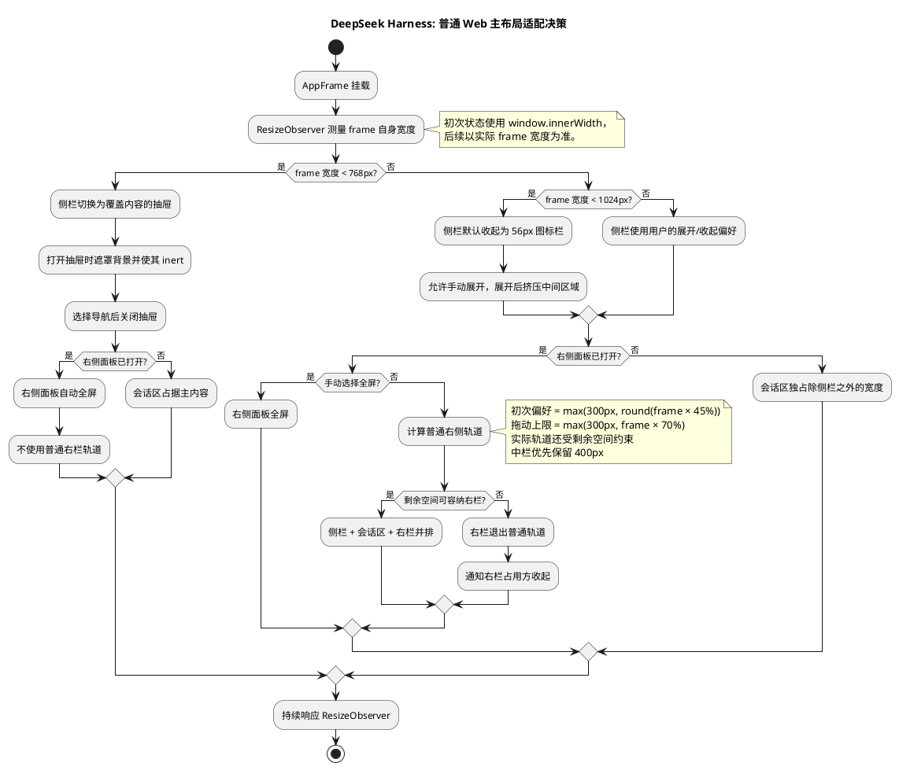
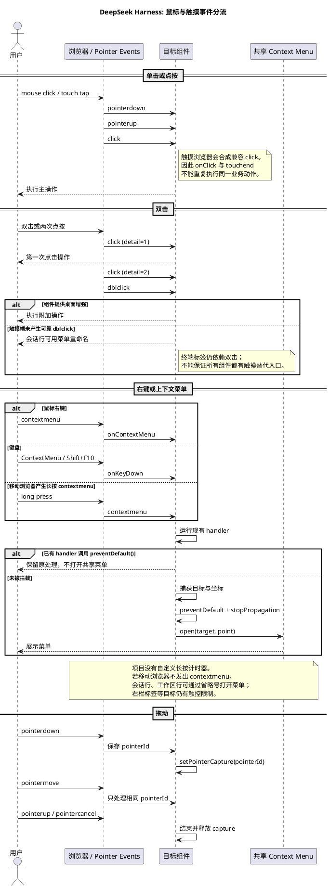
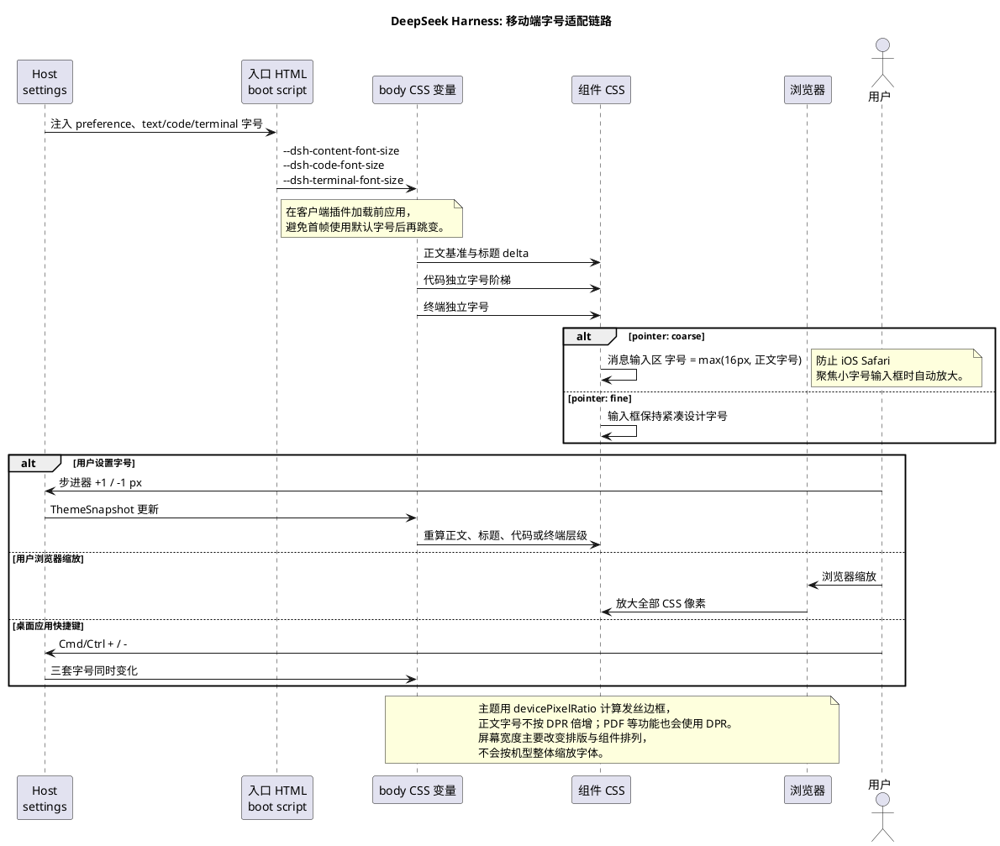

关联：Client 加载与页面插槽源码入门、Desktop 方案。

设想一个具体过程：你在电脑上同时查看会话、文件和终端，随后用手机打开同一个应用。三列怎么安排？没有鼠标右键时如何重命名？软键盘会不会遮住草稿？把屏幕转横后，面板和输入内容是否还在？这些问题共同构成双端适配。

DeepSeek Harness 的 Web 与 Electron 桌面客户端共用会话界面。本文采用总分结构：先列出双端适配的八个关注点，再按同一顺序分析 DSH 的具体处理、源码依据与现有限制。

初次源码研究基于 `8bd073392e`，本次依据本地 `fcc0ad4621` 复核并重组。文中的源码行为、设计原则和待验收项分开说明；本文没有完成全部设备的真机验收，也不把一处组件实现概括为全局保证。

## 总览：双端适配需要关注哪些问题？

适配首先要回答八类问题：空间够不够、内容是否可读、操作能否触达、输入是否连贯、关键内容是否被遮挡、弹层焦点是否正确、状态如何保留，以及运行环境有哪些差异。下面的图是全文目录，后文按 01—08 逐项展开。


图中列的是需要检查的问题，并不表示 DSH 已经全部解决。性能、弱网和后台恢复是跨场景的补充验收项，放在文末；它们也没有在本文中完成全面审计。

接下来每节都先说明用户会遇到什么，再对应到 DSH 的实现。宽度、输入能力、移动平台和桌面运行时分别负责不同判断，不能合并成一个“是否手机”的开关。

## 一、空间布局：三栏放不下时，先保留什么？

### 共用界面，但分别判断适配信号

DeepSeek Harness 的 Web 页面由一组客户端插件组装。`ui-layout` 占据根插槽，渲染三列 `AppFrame`：左侧导航、中间会话和右侧面板。会话、侧栏和具体功能仍然由各自的插件提供。

这与“先写一个桌面应用，再写一个手机应用”不同。主界面的信息架构保持一致，变化集中在布局外壳和局部组件。插件如何进入页面、如何注册插槽，可以继续阅读 Client 加载与页面插槽源码入门。

这种设计适合以对话为主的界面。手机和电脑都需要会话正文、输入框和导航，差别主要在于这些区域如何共享有限的屏幕空间。

| 要回答的问题 | 读取什么信号 | DSH 中的例子 |
| --- | --- | --- |
| 空间够不够？ | 框架的实际宽度、剩余列宽 | 侧栏收起、抽屉、普通右栏能否保留 |
| 设备怎么操作？ | `pointer`、`hover`、事件的 `pointerType` | 输入字号下限、悬停层、图像平移 |
| 是否涉及移动平台行为？ | `isMobileDevice()` | 自动聚焦、软键盘、少量移动端控件行为 |
| 是否运行在桌面外壳？ | 桌面运行时与平台信息 | 标题栏、原生菜单、系统文件拖出 |

这些信号可以组合：桌面窄窗口需要窄屏布局，触屏电脑需要触摸友好的操作；移动平台识别不决定主布局断点。源码：AppFrame.tsx、focus.ts。

### 从三栏到窄屏布局

电脑可以同时显示导航、会话和文件面板；手机上照搬三列，会让正文几乎没有宽度。要先决定区域的优先级，再确定断点与列宽。

### 先测量真正可用的宽度

主布局第一件重要的事，是确定自己有多少宽度可用。

`AppFrame` 初始用 `window.innerWidth` 建立布局状态，但随后通过 `ResizeObserver` 观察 `AppFrame` 自身的盒子，而不是持续把窗口宽度当作布局宽度。更新通过 `requestAnimationFrame` 节流，避免连续触发布局。

源码：AppFrame.tsx。

这个细节在桌面客户端里尤其重要。Electron 窗口可能包含标题栏或其他外壳区域，真正留给 React 应用的尺寸不一定等于整个窗口。布局随实际框架变化，比死记浏览器窗口尺寸更可靠。


### 导航从常驻侧栏变成抽屉

主布局有两个关键宽度：`1024px` 和 `768px`。

| 可用宽度 | 左侧栏 | 主要变化 |
| --- | --- | --- |
| `>= 1024px` | 默认展开，可收为图标栏 | 右栏开启且空间足够时可并排三列 |
| `768px–1023px` | 自动收为图标栏 | 用户仍可手动展开，展开后会挤压中间区域 |
| `< 768px` | 侧栏变为覆盖内容的抽屉 | 抽屉不占布局列宽；选择导航项后关闭 |

以上表格以普通 Web 页面为例。macOS 桌面和带 Windows 标题栏的窗口收起侧栏后不保留图标栏；后者低于 768px 时也不切换抽屉。

断点定义在 columns.ts：

- `SIDEBAR_AUTO_COLLAPSE = 1024`：低于此宽度，侧栏先收起。
- `SIDEBAR_DRAWER_BREAKPOINT = 768`：低于此宽度，侧栏改为抽屉。

### 为什么不让侧栏一直占一列

如果 390px 宽的屏幕上仍保留 264px 侧栏，中间会话区几乎没有可用空间。因此小屏时侧栏不再参与列宽计算，而是浮在内容上，并由遮罩和 `inert` 把被覆盖的界面隔开。

抽屉宽度还有上限：

```text
min(保存的侧栏宽度, 可用宽度 - 48px)
```

保留 48px 是为了让用户仍能看出抽屉覆盖在会话界面之上，而不是误以为已经进入另一个页面。

### 抽屉态的实现：状态位、零宽轨道和覆盖层

抽屉没有换成另一套侧栏组件。`SidebarRoot` 始终是同一个组件，`AppFrame` 通过 `sidebar` 插槽多传一个 `drawer` 布尔值，侧栏再据此切换尺寸、语义和交互。实现分成三层。

**一、开合状态。** 抽屉的开合不复用侧栏的宽度偏好，而是 store 里的 `narrowExpanded` 覆盖位。`AppFrame` 用它推导窄屏下的收起状态：

```tsx
const narrow = viewport < SIDEBAR_AUTO_COLLAPSE
const drawer = viewport < SIDEBAR_DRAWER_BREAKPOINT && !windowsTitlebar
const sidebarCollapsed = narrow ? !layoutInfo.narrowExpanded : layoutInfo.sidebar === 0
```

低于 `1024px` 时，切换按钮只翻转 `narrowExpanded`，`layoutInfo.sidebar` 保存的像素宽度不动。因此把窗口从手机宽度拉回桌面宽度，用户原来的侧栏宽度仍然生效。源码：stores.ts、AppFrame.tsx。

**二、网格轨道。** 抽屉模式下侧栏偏好按 `0` 参与列宽计算，收起态宽度也取 `0`：

```tsx
const collapsedWidth = drawer || darwin || windowsTitlebar ? 0 : SIDEBAR_COLLAPSED
const cols = computeColumns(viewport, drawer ? 0 : sidebarPreference, ...)
```

网格第一条轨道因此宽度为零，会话区和右栏重新分配整个宽度；窄屏也不会留下 56px 图标栏。`drawer` 的判定排除了带原生标题栏的 Windows 桌面窗口，那里由标题栏自己的收起布局处理。源码：AppFrame.tsx。

**三、覆盖层样式。** 网格不再决定侧栏位置后，CSS 把这一列改成绝对定位的浮层：

```css
.frame[data-sidebar-drawer] .sidebarCol {
  position: absolute;
  inset: 0 auto 0 0;
  z-index: 71;
  transform: translateX(0);
  transition: transform var(--ds-transition-duration-slow) var(--ds-ease-in-out);
}
.frame[data-sidebar-drawer][data-sidebar-collapsed] .sidebarCol {
  transform: translateX(-100%);
  visibility: hidden;
  transition:
    transform var(--ds-transition-duration-slow) var(--ds-ease-in-out),
    visibility 0s linear var(--ds-transition-duration-slow);
}
```

`visibility` 的延迟等于位移时长，所以滑出过程中内容仍可见，滑完才真正隐藏。展开回 `translateX(0)`，收起走 `translateX(-100%)`，方向固定从左侧进出。抽屉没有分隔边框，也不渲染宽度拖拽手柄，因为覆盖层没有可拖的列边界。源码：AppFrame.module.css。

进入抽屉模式时还有一条即时规则：如果侧栏原本是收起的图标栏，`data-sidebar-instant` 会关闭过渡，抽屉直接以隐藏状态出现；如果侧栏原本展开，收起动作保留一次位移过渡，用户能看到它滑出屏幕。源码：sidebar-drawer.e2e.ts。


### 右栏先满足空间约束，再决定呈现方式

右侧面板和会话区共享宽度。它不能只按照用户拖出的宽度机械并排，否则中间正文会被挤到无法阅读。

#### 普通右栏的让位顺序

打开普通右侧面板时，列宽计算遵循以下顺序：

1. 尽量为中间会话区保留 `400px`。
2. 右侧面板最小为 `300px`。
3. 空间不足时，右侧面板退出普通轨道。
4. 只有右栏轨道已经移除后，中间区域才继续变窄。

右侧面板第一次打开时，宽度偏好取框架宽度的 `45%`（四舍五入），且不低于 `300px`。拖动后保存像素偏好，拖动上限取 `max(300px, 框架宽度 × 70%)`；普通轨道的实际宽度还受剩余空间约束。

相关常量都在 columns.ts。更完整的开合、拖拽和全屏行为见 ui-layout 中文说明。

#### 窄屏自动全屏，宽屏可手动全屏

框架宽度低于 `768px` 时，已展开的右侧面板会自动采用全屏形态。达到 768px 只表示不再自动全屏：普通右栏仍须满足空间约束，宽屏也可手动选择全屏。空间不足会收起普通右栏，不会因此自动改为全屏。这样文件、浏览器或终端面板能使用完整视口，而不是在一个极窄的第三列里继续压缩。

退出全屏时：

- 窄屏会同时收起右侧面板。
- 窗口重新变宽，不会自动重新打开已经关闭的面板。
- 面板内部标签和内容树尽量保持挂载，切换呈现形式不会因此重建全部 Tab。

实现和用户行为见 ui-sidebar-right 中文说明。

同一个右栏可以在停靠列和覆盖视口之间切换，但剩余空间不足与自动全屏仍是两条不同的判断。

### 功能页面仍须单独重排

三列布局决定应用外壳，但功能页面不一定适合沿用同一个断点。

例如：

- 设置页面在低于 `768px` 时铺满视口，把左侧分区导航改成顶部横向滚动条带。
- 文件浏览器在手机宽度下让目录树或文件内容单独占据视口，打开文件后用返回操作切换层级。
- 命令搜索菜单在桌面端自动聚焦搜索框，在手机和平板上要求用户点击，避免意外弹出键盘。

因此，阅读代码时不能只搜索一个全局断点，还要看具体页面的 README 和测试。仓库把手机验收的最小宽度设为 `390 CSS px`，主要要求是不能出现非预期重叠、裁切、全页横向滚动或无法访问的主要操作。

## 二、阅读体验：长文本与字号，怎样保持可读？

### 长标题和草稿如何避免溢出

即使外层已经切成单列，里面的长文件名、长链接和草稿仍可能撑破页面。布局容器能收缩，不等于内容已经可以阅读。

DSH 的会话与工作区行在部分文本位置组合使用 `min-width: 0`、`overflow: hidden`、`text-overflow: ellipsis` 和 `white-space: nowrap`，让行内文本截断，而不是把整行撑宽。消息输入区 草稿则采用 `white-space: pre-wrap` 和 `overflow-wrap: anywhere`，保留换行并允许长串折行，草稿区还提供纵向滚动。源码：Rows.module.css、InputBar.module.css。

不同内容不能统一用省略号处理：导航标签可以截断，正文通常需要折行，代码和大表格则需要根据语义决定局部滚动或其他展示方式。这里后一句是适配时的检查原则，不代表本次已核实 DSH 每种代码、表格和文件预览的实现。

验收时要放入真实的长文本，并确认截断后仍有查看完整信息的途径；不能仅凭页面没有横向滚动就判断通过。

### 手机上看不清，是否需要整体缩放

DeepSeek Harness 没有根据设备型号、屏幕物理宽度或 `devicePixelRatio` 计算一个“手机字号”。它主要使用 CSS 像素，并让浏览器、用户设置和组件角色共同决定最终字体大小。


### 先区分 CSS 像素与内容缩放

Web 入口声明：

```html
<meta name="viewport" content="width=device-width, initial-scale=1" />
```

这里使用设备的 CSS 布局宽度，并未声明 `maximum-scale=1` 或 `user-scalable=no`。CSS 像素与物理像素不是同一单位，字号不会因为屏幕是 2×、3× 就自动成倍增加。源码：apps/web/index.html。

还要区分三种操作：浏览器页面缩放、移动浏览器的双指页面缩放，以及预览组件自己的内容缩放。不能看到一个缩放处理器，就推断它处理了全部缩放场景。`AppFrame` 根据实际盒子宽度更新布局；预览区的 `ZoomViewport` 另外拦截带 `ctrlKey` 的滚轮事件来改变预览缩放。源码：AppFrame.tsx、ZoomViewport.tsx。

### 正文、代码和终端各有独立字号轴


主题设置维护三个角色：

| 角色 | CSS 变量 | 默认值 | 可设置范围 | 影响范围 |
| --- | --- | --- | --- | --- |
| 正文 | `--dsh-content-font-size` | `14px` | `10–22px` | 会话正文、用户气泡、消息输入区 草稿和正文标题阶梯 |
| 代码 | `--dsh-code-font-size` | `11px` | `10–16px` | 代码块、行内代码和工具输出 |
| 终端 | `--dsh-terminal-font-size` | `13px` | `10–20px` | 右侧终端 |

定义见 theme-settings.ts 和 ui-theme 中文说明。

正文设置不是把所有界面控件乘以一个比例，而是作为一组排版 token 的基准。正文大小改变多少，标题和行高就平移多少：

```text
--dsh-content-font-delta = 正文字号 - 14px

正文  14px + delta
H4    14px + delta
H3    18px + delta
H2    19px + delta
H1    21px + delta
行高  24 / 26 / 28 / 30px + delta
```

源码：gradient-shadow-text.css。

二级正文还使用 `--dsh-content-font-size-secondary`。设置值不超过 14px 时，它比正文小 1px；大于 14px 时，它比正文小 2px。表格、流内标题和摘要会跟随这个较小的阶梯，而标签、时间、工具摘要等紧凑 UI 文本保持固定字号。

### 设置值在首帧前生效

字号是持久化的 `ui-theme` 设置。Host 在返回入口 HTML 时，把当前三个字号注入页面脚本；脚本在客户端插件外壳加载前把变量写到 `body.style`。因此页面不会先用 14px 绘制，等插件启动后再跳到用户选择的字号。

源码：boot-theme.ts。

设置页中的步进器每次增减 1px，并按角色范围限制取值。步进器会立即更新主题快照，再通过 Host settings API 持久化。


### 触摸输入框有 16px 下限


粗指针设备上，文本输入控件使用至少 16px：

```css
@media (pointer: coarse) {
  .card {
    font-size: max(16px, var(--dsh-content-font-size, 14px));
  }
}
```

主要目的是避免 iOS Safari 聚焦小于 16px 的文本输入框时放大页面。消息输入区、设置中的字体输入框、侧栏搜索和任务编辑字段都采用这一处理。源码：InputBar.module.css 和 FontFamilyRow.module.css。

规则写在 消息输入区 的 `.card` 上，编辑区再通过 `font-size: inherit` 继承，让草稿与占位符使用相同的字号基准。这是输入控件的下限，不表示整个界面都统一变成 16px；用户设置更大的正文字号时，`max()` 仍选择用户设置。

### 屏幕宽度改变排版，不整体缩放字体


`@media (max-width: 767px)` 主要改变布局。例如字号设置行在大屏上横向排列，在窄屏上改成标题、说明、控件纵向排列，但标题仍为 14px、说明仍为 12px。

源码：FontSizeRow.module.css。

仓库规范也明确要求：不能为了消除溢出而全局缩小字号，点击目标不能随之缩小。390 CSS px 是主要移动端验收宽度，内容应通过换行、重排和滚动解决空间问题。

### DPR 和机型信息用在哪里

`devicePixelRatio` 在当前主题样式中用于计算发丝边框宽度，让 0.5 CSS px 的边框落到整物理像素上；它不参与正文字号计算，但 PDF 渲染等其他功能也会使用 DPR。源码：styles.ts。

字体家族则使用跨平台系统字体栈，例如 Apple 平台优先 `-apple-system` 和 `PingFang SC`，Windows 优先 `Segoe UI` 和 `Microsoft YaHei`，从而让同一套 CSS 在不同系统上选择可用的中文字体。用户也可以在设置里填写本机字体名称，未安装时回退到内置字体栈。

因此，当前实现依赖的是：

- 正确的 CSS viewport。
- 浏览器自身的缩放能力。
- 用户可调的正文、代码和终端字号。
- 触屏文本输入框的 16px 防缩放下限。
- 固定 UI 角色与正文规模分开控制。

它没有直接读取手机型号或按屏幕分辨率生成字号，也不依赖媒体查询给某一款手机单独写字体大小。

字号以外还要检查点击区域和间距。文字能放下，并不能说明相邻按钮容易点中；本次没有测量全部控件的触摸目标大小，因此不作全局达标结论。

## 三、操作入口：没有鼠标，还能完成任务吗？

例如电脑上可以双击会话标题重命名，但手机用户需要一个找得到、点得到的入口。手势适配既要检查事件能否触发，也要检查功能是否还有替代入口。

鼠标和触摸最终都会产生 `click`，但右键依赖 `contextmenu`，双击依赖 `dblclick`。DeepSeek Harness 没有为这三种手势各写一套统一兼容层，而是把“普通激活”和“附加手势”分开处理。

| 手势 | 主要 DOM 信号 | 项目中的处理方式 |
| --- | --- | --- |
| 单击、点按 | `pointerdown` → `pointerup` → `click` | 使用 `onClick` 完成普通操作；触摸浏览器会合成 `click` |
| 双击 | 两个 `click`，随后 `dblclick` | 作为桌面增强操作，同时通过显式按钮或菜单保留替代入口 |
| 右键 | `contextmenu` | 打开共享菜单；另支持 `ContextMenu` 键和 `Shift+F10` |
| 拖动 | `pointerdown` → `pointermove` → `pointerup` / `pointercancel` | 使用 Pointer Events 和 pointer capture |
| 长按 | 浏览器可能生成 `contextmenu` | 没有自行实现长按计时器；不能把它当成所有触摸浏览器的可靠入口 |

### 单击：统一使用 click

按钮、文件引用和会话行等普通操作使用 React 的 `onClick`。手机浏览器在点按后会生成兼容的鼠标事件和 `click`，所以组件不需要再额外绑定 `touchend` 来做同一个动作。

如果一个操作同时监听 `touchend` 和 `click`，一次点按就可能执行两次。项目中的 Tooltip 测试专门验证了：触摸结束后即使浏览器再补发兼容鼠标事件，按钮动作也只执行一次。源码：Tooltip 测试。

单击是主要操作，因此要保证键盘也有入口。例如会话行在 `Enter` 或空格时调用同一个 `onOpen`；文件、链接和工具按钮则使用原生按钮或链接语义。

### 双击：作为附加操作，不成为唯一入口

双击建立在单击之后。浏览器通常先发送第一次 `click`，再发送第二次 `click`，然后发送 `dblclick`，所以单双击绑定在同一元素时必须明确第一次点击是否也会执行操作。

项目里有两种典型做法：

- 会话标题双击打开重命名。未归档 Session 的第一次点击仍会打开会话，第二次点击才触发重命名。这样不需要等双击判定超时才响应单击，但双击也会保留第一次点击的结果。源码：Rows.tsx。
- Trajectory 记录单击选中，双击展开或折叠分组。单击是基本操作，双击提供更快的桌面操作。源码：TrajectoryTable.tsx。

这些组件没有自己实现“两次 `touchend`”检测，也没有用统一的 300ms 计时器把两个点按合并成双击。触摸端能否稳定产生 `dblclick` 取决于浏览器和元素：

- 移动浏览器常把双击保留给页面缩放或文字选择。
- 触摸事件合成顺序与桌面鼠标并不完全一致。
- 按钮上的点按通常产生 `click`，但不应把 `dblclick` 当作必须可用的交互。

因此，双击适合加速已有操作，不能承载唯一功能。会话重命名在行操作菜单中也有 Rename 项，即使双击没有触发，用户仍可以通过省略号按钮打开菜单。

终端标签标题目前直接监听 `dblclick` 重命名，没有单独的触屏长按实现；这是组件级行为，不能据此推断所有双击都有等价的触摸手势。源码：TerminalTitle.tsx 和 dockkit 的已知限制。

### 右键：共享 contextmenu，触摸端保留显而易见的入口

会话、工作区、文件、链接、图片和右侧标签共享 `ui-context-menu`。组件把 `getTriggerProps()` 展开到目标元素上，由它统一监听：

- 鼠标右键产生的 `contextmenu`。
- 键盘 `ContextMenu` 键。
- `Shift+F10`。

打开时，处理器先执行目标已有的监听器；如果已有监听器调用了 `preventDefault()`，共享菜单不再抢占。真正打开时，它调用 `preventDefault()` 和 `stopPropagation()`，保存点击目标和坐标，再打开菜单。源码：trigger.ts。

```tsx
const { getTriggerProps } = useContextMenu()

<button
  {...getTriggerProps({
    kind: 'session',
    value: { sessionId, displayTitle },
  })}
/>
```

这里没有 `setTimeout` 长按检测。某些移动浏览器会在长按时发出 `contextmenu`，共享处理器会正常响应；另一些浏览器、元素或手势不会发出这个事件，项目也没有自行模拟。“长按等于右键”因此不是当前实现提供的统一保证。

为了让主要菜单在触摸端可达，会话行和工作区行还提供可见的省略号按钮。右栏标签的上下文菜单目前以次键按下为主。看源码时要把“共享右键处理器”和“每个目标是否提供触摸替代入口”分开判断。

### 拖动：统一使用 Pointer Events

侧栏宽度、会话宽度、时间轴拖选和停靠面板拖动都使用 Pointer Events，而不是只监听 `mousedown` / `mousemove` / `mouseup`。一个手势会保存 `pointerId`，并在开始时调用 `setPointerCapture()`：

```tsx
event.currentTarget.setPointerCapture(event.pointerId)
```

这样手指移出原元素后，后续移动和抬起仍由原组件接收；第二个手指或另一支指针不会误结束当前手势。结束或取消时释放 capture，并处理 `pointercancel`。源码：AppFrame.tsx 和 dockkit pointer.ts。

手势区域会按需要设置 `touch-action`，防止浏览器的平移或滚动先夺走触摸。比如侧栏拖拽手柄设置 `touch-action: none`。这只用于确实要接管连续手势的区域，普通页面和滚轮滚动区域不能全局禁用。

图像预览又是相反的选择：平移手势显式检查 `pointerType`，不是 `mouse` 时直接退出，触摸端把平移让给原生滚动；双指捏合缩放复用 Chromium 把触控板捏合合成为 `ctrl+wheel` 事件的机制，按该事件处理。区域级 `touch-action` 决定手势入口，`pointerType` 检查决定哪个层级接管手势，两者配合使用。源码：pan.ts 和 ZoomViewport.tsx。

### 悬停与触摸：动作照常执行，提示不要阻碍点按

悬停不是点击。项目在 `(hover: hover)` 下显示悬停背景，触摸设备上的操作按钮直接可见。普通按钮在触摸上仍然执行原有 `onClick`，不因为 Tooltip 没有出现而失效。

Tooltip 与 HoverCard 的判定是同一个三元结构：事件的 `pointerType` 为 `touch` 时直接不显示悬停层；鼠标事件还要求 `matchMedia('(any-hover: hover)')` 证明系统有悬停能力，查询不可用的环境按没有能力处理。源码：Tooltip.tsx 和 HoverCard.tsx。

携带补充说明、以点按触发的 Tooltip，在触屏上改为点按固定、再点按或移出取消；子菜单的悬停触发先做同样的检查。

### 实现手势时的兼容原则

从这些源码可以归纳出五条规则：

1. 普通操作只绑定 `onClick`，不要再复用 `touchend` 执行同一动作。
2. 需要鼠标右键和键盘一致入口时，使用共享 `contextmenu` 处理器。
3. 触摸端的右键功能必须有可见按钮或菜单；不能依赖长按一定触发 `contextmenu`。
4. 双击只能作为附加手势；第一次点击、菜单按钮或其他显式控件要能完成对应任务。
5. 拖动使用 Pointer Events、`pointerId`、pointer capture 和 `pointercancel`，再按区域设置 `touch-action`。

## 四、输入过程：DSH 怎样适配手机键盘与输入法？

输入适配要考虑一次完整操作：进入会话、开始打字、选词、发送，再到任务结束。电脑用户通常希望切到会话就能打字；手机用户如果只是阅读，自动聚焦编辑器却可能弹出软键盘、遮住正文。DSH 因而在几个具体时点采用不同的焦点策略，而不是仅根据窗口宽度调整输入框。

### 1. 进入会话：电脑自动聚焦，移动端等待主动点击

`InputBar` 的 effect 在 `locked`、`sessionId` 或 `editor` 变化时重新判断。如果编辑器锁定或尚不存在，就不聚焦；如果 `isMobileDevice()` 返回真，也跳过自动聚焦。其余情况调用 `focusDraftEditor()`，把焦点交给编辑器，恢复编辑选区，并将选区滚入草稿区的可见范围。

这意味着：电脑端切到可编辑会话后可以继续打字；识别为移动设备时，不会因为这段挂载或会话切换逻辑主动聚焦编辑器，用户需点击后再输入。这里是应用是否主动聚焦的区别，并不是应用直接控制系统键盘显示。

移动设备判断识别 Android、iPhone、iPad、iPod，以及 `platform === 'MacIntel' && maxTouchPoints > 1` 的桌面模式 iPad；判断结果缓存到本次页面生命周期结束。它不根据屏幕宽度判断，也不检测外接键盘是否存在。因此窄电脑窗口仍可自动聚焦，而手机即使横屏或接了键盘，也不会因此切换到电脑策略。源码：InputBar.tsx、focus.ts。

### 2. 发送并清空草稿：移动端把焦点移出文本编辑区

`installDraftKeyboardDismissal()` 监听编辑器更新。只有更新带有 `DRAFT_SUBMITTED_TAG`，并且当前设备被识别为移动设备时，才继续判断：焦点是否仍在该编辑器根元素上、草稿文本是否已经为空、外层卡片是否存在。条件全部满足，就把焦点交给带 `tabIndex={-1}` 的非文本外层卡片，并设置 `preventScroll: true`。

它的适配目的，是在提交后的空草稿上结束文本编辑焦点，让移动浏览器有机会收起软键盘，同时保留 消息输入区 的键盘位置。如果用户已经点到另一个控件，这段逻辑不会把焦点抢回来；没有清空文本、没有提交标记的更新，也不触发这次转移。桌面设备跳过这一移动端专用分支。

因此不能简写成“任何发送都会立即收键盘”，也不能把草稿提交更新等同于服务端已经成功完成任务。源码：view-binding.ts、InputBar.tsx。

### 3. 提交阶段结束：恢复操作位置，不抢走其他焦点

`InputBar` 记录这一轮输入是否经历过 `machineBusy`。“忙碌”指模型裁决中（adjudicating）、提交中（submitting）、发送中（sending）三个相位，期间输入框只读。从这些输入阶段退出时，才考虑恢复焦点：仅当编辑器可用且未锁定，且当前活动元素为空或是 `document.body`（用户没有点到别处），电脑端把焦点交回编辑器，移动端聚焦非文本外层卡片。这不表示模型已经生成完回复；任务仍在运行时，输入框也可能已经恢复可编辑。

例如用户等待任务时已经点击了其他按钮，DSH 会保留那个按钮的焦点；如果焦点落回了页面本身，电脑端恢复可打字的位置，移动端则保留 消息输入区 的操作位置，避免恢复到文本编辑区而重新弹出键盘。源码：InputBar.tsx。

| 时点 | 电脑端策略 | 被识别为移动设备时 |
| --- | --- | --- |
| 挂载、切换会话或解除锁定后的自动聚焦判断 | 条件满足时聚焦编辑器并恢复选区 | 跳过自动聚焦，等待主动点击 |
| 带提交标记的更新清空草稿后 | 不执行移动端专用转焦点分支 | 焦点仍在编辑器时，转到非文本卡片 |
| 提交阶段结束（退出 machineBusy）| 焦点落在页面时恢复到编辑器 | 同条件下恢复到非文本卡片 |
| 用户已经聚焦其他控件 | 提交阶段结束时保留其焦点 | 提交清空和提交阶段结束均有相应的不抢焦点判断 |

### 4. 长草稿与触摸输入：保留光标可见性，设置输入字号下限

`focusDraftEditor()` 使用 `preventScroll`，避免自动聚焦把整段会话意外滚走；随后 `revealDraftSelection()` 根据真实 DOM 选区与草稿滚动区的矩形，按需调整草稿区的 `scrollTop`，让光标所在位置可见。恢复后的草稿从空变为非空时，也会尝试显示选区，但该 effect 不主动聚焦，不应因此抢走其他控件的焦点。

触摸输入的字号策略则读取另一种信号：`@media (pointer: coarse)` 下，消息输入区 的 `.card` 使用 `max(16px, 正文字号)`，编辑区继承该字号，主要用于避免 iOS Safari 聚焦小字号文本时自动放大。这条规则不依赖 `isMobileDevice()`；粗指针和移动平台分别解决不同问题。源码：view-binding.ts、InputBar.module.css。

### 5. 输入法选词：区分“确认文字”与“提交草稿”

中文输入中的回车可能只是确认候选词。消息输入区 在 `keymap.ts` 中同时检查 `event.isComposing`、兼容信号 `event.keyCode === 229` 和局部组合输入状态。`compositionstart` 开始保护；`compositionend` 后还保留 10ms 的短暂保护时间，用来覆盖 Safari 可能在组合结束后才送到的结束按键。它是当前实现的兼容窗口，不是所有浏览器都遵守的事件时间保证。

进入回车处理时，普通 `Shift+Enter` 保留换行；识别为组合输入的回车停止进入提交和编辑器兜底换行分支，不阻止浏览器完成选词。非组合输入的回车先交给菜单仲裁，菜单处理后不再发送；继续到提交分支时，还会拒绝按住回车产生的 `repeat` 事件，避免连续发送。这些保护同时适用于手机和电脑上的输入法，不是一条只针对手机的规则。

共享 `observeComposition()` 另外为快捷键分派、菜单和模态层等调用方提供组合输入保护，与 消息输入区 的局部观察器是不同实现。源码：keymap.ts、keyboard-composition.ts。

### 6. 本节能确认什么，还不能确认什么

以上能确认的是：DSH 按移动平台区别处理几个自动焦点时点，按粗指针设置输入字号下限，并为输入法与不同浏览器的按键时序增加保护。它没有检测外接键盘来动态重选自动聚焦策略；焦点转移也不等于已经完成所有系统键盘开合的真机验收。键盘出现后是否遮住发送按钮、横屏后的可见高度和安全区域，仍属于下一节需要单独检查的问题。

## 五、可见区域：关键内容会不会被遮住？

宽度足够不代表高度足够。手机软键盘出现、浏览器工具栏展开、横竖屏切换，都可能减少实际可见区域；底部输入框和发送按钮尤其需要检查。

限高在全仓是一个统一公式：菜单与各级子菜单、任务和时间选择器、面板弹层与告警都以`max-height: calc(100dvh - 12px - max(12px, var(--dsh-frame-overlay-top, 12px)))` 的同一形态收口，顶内同时扣除窗口外壳占位和各自的最小边距。

这一约束建在动态视口上：`dvh` 随浏览器工具栏伸缩和软键盘展开自动重算，替代传统 `100vh` 的固定值；不支持 `dvh` 的引擎经 `@supports (height: 100dvh)` 回退，停靠面板的浮动位移和高度也被 `100dvh` 钳住。源码：Menu.module.css、ModelSelect.module.css、RiskConfirmation.module.css。

指针定位菜单的坐标修正只有这一处：打开时捕获的事件坐标相对视觉视口原点，而弹层的 `position: fixed` 锚定布局视口，WebKit 引擎上两个原点在捏合、平移或键盘推移后会错开。引擎判定走 `CSS.supports('-webkit-backdrop-filter', 'none')` 特性查询，修正只在打开瞬间对捕获点做一次，后续平移不连续跟动。源码：Menu.tsx。

窗口外壳的顶部让位由变量承担：`html[data-platform='darwin']` 或 `html[data-windows-titlebar]` 上，`--dsh-frame-overlay-top` 记录交通灯或原生标题栏叠加的顶部空间，全屏时重置为固定值；portal 出去的浮层以 `top: max(12px, var(--dsh-frame-overlay-top, 12px))` 落在该线之下。会话内的可见带是另一种来源：滚动视口和 消息输入区容器用 ResizeObserver 实测并发布高度变量，导航控件据此定位在正文可见带上。源码：AppFrame.module.css 和 ConversationContent.tsx。

两项此前存疑的机制已逆向核实：安全区域留白在全仓 `src` 中没有命中，布局不依赖 `env(safe-area-inset-*)`；软键盘遮挡也没有专门的 JS 处理——除上述一次性视觉视口修正外，没有键盘监听，viewport 也不含 `interactive-widget`，键盘带来的可见区域变化完全交给 `dvh` 与文档流自适应。

提交时把焦点移出编辑器让键盘收起，属于焦点行为而非可见区域处理；因此刘海、底部系统手势区在默认行为下的表现，以及键盘收起后布局回流的正确性，仍是需要真机确认的检查项，而不是代码中已实现的能力。

## 六、弹层焦点：抽屉打开和关闭后，焦点归谁？

抽屉盖住正文以后，如果 Tab 仍能进入背景输入框，或点遮罩时穿透触发正文按钮，画面看似正确，操作却已经混乱。弹层适配还包含交互隔离和焦点管理。


抽屉浮在会话上之后，被覆盖的界面必须同时不可点、不可聚焦，键盘用户也要能感知到模态状态。

- **遮罩**：`drawer` 为真时 `AppFrame` 才挂载 `[data-sidebar-mask]`，`z-index: 70`，位于抽屉 `71` 之下、全屏右栏 `40` 之上；透明度随开合过渡，关闭时 `pointer-events` 设为 `none`。点击遮罩调用 `toggleSidebar()`。
- **背景 inert**：抽屉打开时，中间会话区、右栏、`shell.bottom` 和窗口控件座位都设置 `inert`，鼠标、键盘和辅助技术都无法操作被遮住的界面。
- **对话框语义**：`SidebarRoot` 在 `drawer` 为真时渲染 `role="dialog"`、`aria-modal` 和 `tabIndex={-1}`，并复用共享的 `useModalLayer()`：打开时把焦点移入抽屉，优先落到带 `data-modal-autofocus` 的折叠按钮；`Tab` 在抽屉内循环；`Escape` 关闭抽屉。
- **焦点交接**：关闭时 `useModalLayer()` 把焦点还给打开抽屉前的元素；如果关闭瞬间焦点仍在侧栏里，`SidebarRoot` 会把焦点交给 `[data-sidebar-opener]`，也就是 frame 顶部控件座位里的打开按钮，避免焦点落到已经隐藏的列。

源码：SidebarRoot.tsx、HeaderLeadingControls.tsx、useModalLayer.ts。

抽屉关闭没有独立状态机：遮罩点击、`Escape` 和抽屉内选择导航项，最终都写入同一个 `narrowExpanded = false`。导航选择由 `selectPanel` 在框架宽度低于 `768px` 时完成；低于 `1024px` 时打开右侧面板也会收起抽屉。


这里能确认抽屉具有相应处理，不能据此声称整个应用已经完成无障碍验收。还要分别检查菜单、弹窗、焦点提示、控件名称及屏幕阅读器反馈。

## 七、状态保留：窗口变化后，哪些状态应留下？

用户在中等宽度手动展开侧栏，再把窗口缩成手机宽度，通常不希望抽屉突然挡住正文；但也不希望回到宽屏后丢掉原先的尺寸偏好。临时展开、宽度偏好和内容状态需要分开讨论。

### 临时展开状态在跨断点时清除


在 768px 至 1023px 之间，用户手动展开侧栏是一个临时覆盖状态。窗口跨过 1024px 或 768px 时，这个状态会清除：

- 宽窗回到原先的侧栏展开偏好。
- 中间宽度回到自动收起状态；普通 Web 保留图标栏。
- 普通 Web 的手机宽度回到抽屉关闭状态。

源码：stores.ts。

因此，“用户上次展开过”不会被错误地带到另一个布局区间。

### 右栏保留偏好，但关闭状态不会自动反转

右栏第一次打开后保留像素宽度偏好；框架缩放和面板关闭不会直接把它重置。窄屏退出全屏时会同时收起右栏，随后拉宽不会自动打开已关闭的面板。呈现形式切换尽量保留内部标签和内容树。源码：stores.ts、ui-sidebar-right 中文说明。

这只说明布局和右栏的相应状态策略。草稿、会话滚动位置、刷新恢复和切后台恢复各有自己的存储与生命周期，需要另行核对，不能从“同一组件仍挂载”推导出所有状态都不会丢。

## 八、运行环境：同一套界面，桌面还需处理什么？

Electron 桌面版继承 Web 客户端的三列布局，同时还要避开操作系统窗口装饰。

- macOS 使用隐藏式标题栏时，要为交通灯按钮旁的重开和新建控件预留横向空间。
- Windows 桌面版会为原生标题栏预留顶部高度，并让全屏右侧面板避开标题栏。
- 普通浏览器页面没有这些原生窗口标记，因此不应用桌面 chrome 的空间补偿。

这部分的系统窗口背景、进程模型和版本约束，可以继续阅读 Desktop 方案。

### 窗口状态由 preload 发给页面

Electron preload 在页面创建时，把平台、全屏状态和 Windows 原生标题栏信息发给页面：`data-platform`、`data-fullscreen` 两个属性加上标题栏高度变量 `--dsh-windows-titlebar-height`；全屏等后续变化由主进程经 IPC 同步。上文列出的标题栏空间补偿正是读取这些信号生效，浏览器页面没有这些标记，自然不应用桌面补偿。源码：preload-platform.ts 和 preload-windows.ts。

### 右键菜单与文件拖出按端分工

浏览器层共享 `ui-context-menu`，桌面 main 进程再监听 `webContents` 的 `context-menu` 事件：焦点落在可编辑元素或存在选区时弹出系统编辑菜单，`editFlags` 决定剪切、复制、粘贴等项的启禁状态。两层并存，自定义菜单负责业务对象，原生菜单负责系统编辑行为。Windows 上经 IPC 弹出的原生菜单还要把弹出坐标乘回 `webContents.getZoomFactor()`，修正页面缩放造成的坐标偏移。

拖出文件按端选择通道。桌面 preload 暴露 `dshDesktop.fileDrag`，经协议版本校验后走原生拖拽句柄发起系统级文件拖出；Web 客户端回落为浏览器数据拖拽。触发点是同一处，端能力决定走哪条通道。源码：main.ts 和 ui-file-drag 客户端入口。

### 快捷键：统一注册，按端分派

`shortcuts` 包维护统一的命令与键位注册。Web 端在页面 DOM 层匹配按键，键位保存在 `localStorage`；桌面端主进程经 `before-input-event` 把键盘事件转给页面，应用菜单的 accelerator 在主进程单独匹配，两条通道各负责一类输入。桌面运行时缺少键盘桥会直接抛错，不做静默降级。

端差异是显式写出的：字号快捷键 `Cmd+=` / `Cmd+-` 只在桌面运行时注册，Web 端把整体缩放交给浏览器自身快捷键。源码：shortcuts 客户端入口 和 desktop keyboard.ts。

## 附录 A：框架宽度测量的实现细节

源码中的测量 effect 大致如下（省略了一行测试覆盖率注释，其余与当前实现一致）：

```tsx
useLayoutEffect(() => {
  const el = frameRef.current
  if (el === null) return
  let raf: number | null = null
  let disposed = false
  const measure = () => {
    const width = el.getBoundingClientRect().width
    if (width > 0) actions.setViewportWidth(width)
  }
  measure()
  const observer = new ResizeObserver(() => {
    if (disposed) return
    raf ??= requestAnimationFrame(() => {
      raf = null
      measure()
    })
  })
  observer.observe(el)
  return () => {
    disposed = true
    observer.disconnect()
    if (raf !== null) cancelAnimationFrame(raf)
  }
}, [actions])
```

1. **用 `useLayoutEffect` 而不是 `useEffect`**：测量发生在 DOM 布局完成之后、浏览器绘制之前，首帧就能拿到框架真实宽度，不会先用 `window.innerWidth` 画一版、再跳一下。
2. **effect 里先同步测量一次**：store 的 `window.innerWidth` 只是启动值，挂载后立刻用框架宽度覆盖它。
3. **`raf ??=` 合并回调**：`ResizeObserver` 在一次布局中可能触发多次，`??=` 保证同一帧最多排队一次测量；测量本身又放在下一帧渲染前执行，此时这一轮布局已经落定。
4. **`width > 0` 才写入**：框架隐藏或尚未布局时宽度为 0，不能覆盖上一次有效测量。store 里这个字段的注释就是“最后一次正的框架测量值”。
5. **清理三件事**：`disposed` 拦住已经排队但尚未执行的回调，`observer.disconnect()` 停止观察，`cancelAnimationFrame` 撤销待执行的帧回调。组件卸载后不会再有写入。

测量结果写入 `layoutInfo.viewportWidth`，主框架的侧栏与列宽判断以它为准：是否低于 `1024px` 自动收起侧栏、是否低于 `768px` 切换为抽屉、`computeColumns()` 的三栏宽度解算，以及右栏第一次打开时取框架宽度的 `45%` 作为默认宽度。

`setViewportWidth` 还会在跨越 `1024px` 或 `768px` 断点时清掉 `narrowExpanded` 覆盖状态。因此宽度信号不只决定“现在怎么排”，还决定“上一个宽度区间的临时展开要不要保留”。源码：stores.ts。

框架最终仍使用 CSS Grid。React 负责提供离散状态，例如侧栏是否收起、抽屉是否打开、右侧轨道是否存在；网格负责在连续缩放时求解列宽。这样窗口拖动不必等待全部 React 计算完成才更新几何。

## 附录 B：源码阅读顺序

如果要从代码确认这条链路，建议按以下顺序阅读：

1. columns.ts：断点和列宽最小值。
2. stores.ts：窄屏展开、宽度偏好和右栏呈现状态。
3. AppFrame.tsx：宽度测量、抽屉遮罩、Grid 模板和插槽组合。
4. AppFrame.module.css：抽屉、过渡和桌面窗口样式。
5. ui-sidebar-right 中文说明：窄屏全屏右栏。
6. focus.ts：移动设备焦点策略。
7. InputBar.module.css：粗指针下的输入字号。
8. desktop keyboard.ts：原生键盘桥与菜单 accelerator 双轨。
9. keyboard-composition.ts：输入法组合防线。

## 附录 C：三张逻辑图

### 1. 主布局适配决策



### 2. 鼠标与触摸事件分流



### 3. 字号与视口适配链路



## 附录 D：跨场景的性能、恢复与验收清单

### 性能、弱网与后台恢复

手机上打开长会话、滚动大量工具输出、预览大文件，可能暴露电脑上不明显的渲染和内存问题。切后台、断网再联网后，还可能出现显示状态落后、连接恢复失败或重复提交。

这些属于完整双端验收的一部分，但本文没有对相关数据链路、虚拟列表、断线重连和后台恢复做完整源码审计，也没有测量性能。因此这里保留问题清单，不给 DSH 标注“已经解决”：

- 长会话和大文件在目标手机上是否可流畅滚动，内存是否持续增长？
- 页面切后台再回来，任务结果和连接状态是否能正确同步？
- 网络不稳定时，发送是否有明确反馈，重试是否可能重复执行？
- 刷新或进程被系统回收后，用户能恢复哪些内容，哪些不能恢复？

### 将具体操作串起来验收

验收需要覆盖连续操作，而不仅是几张不同宽度的截图。以下是建议执行的清单，不是本文已经运行的测试结果。

| 场景 | 重点检查 |
| --- | --- |
| 普通 Web：390 CSS px 窄屏、768 与 1024 断点两侧 | 抽屉、图标栏、列宽与重开入口是否符合规则 |
| 先打开右栏，再逐渐缩窄和拉宽 | 空间不足收起、自动全屏、手动全屏和关闭状态是否混淆 |
| 手机竖屏与横屏、平板分屏 | 内容重排、临时展开状态、可见操作是否合理 |
| 真实长标题、长链接、多行草稿、代码和表格 | 是否出现整页横向溢出，完整内容能否访问 |
| 软键盘打开和关闭、中文输入法选字 | 输入框与发送按钮是否可见，选词回车是否误发送 |
| 触摸、鼠标、外接键盘 | 主要功能是否依赖右键、悬停、双击或精确拖动 |
| 键盘打开抽屉和菜单，再关闭 | 背景是否隔离，焦点是否进入并正确恢复 |
| macOS、Windows 桌面窗口 | 标题栏、缩放后的菜单位置、快捷键和原生文件操作 |
| 弱网、切后台、刷新及长会话 | 提交结果、状态恢复、性能与失败反馈 |

DSH 仓库的响应式规范以 390 CSS px 作为主要移动端验收宽度，检查非预期重叠、裁切、全页横向滚动和无法访问的主要操作。这个项目基准不替代其他产品对目标设备范围的选择。

从这个案例可以借鉴的是分开确定每种行为的依据：布局看实际空间，触摸交互看输入能力，软键盘等行为看平台，原生功能看运行时；每一项仍须对应到具体组件和验收场景。
