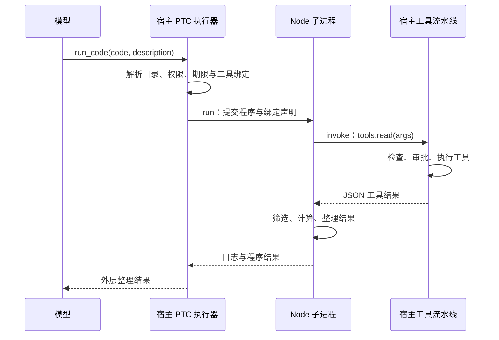

同样分析三份报告，普通模式和 PTC 模式都算出了总下降金额 35。但它们拿到数据、执行计算和处理后续追问的方式不同。

这次我使用官方发布的 DeepSeek Harness 0.2.2-rc.1，在独立配置与演示工作区里实际运行，同一个模型选择为 DeepSeek V4.1 Flash · OpenCode Go。除了按要求限制工具的对照，还增加了一次只给任务、不规定工具的普通模式运行。

先交代结果：普通模式自由选择工具时，先执行 ls 查看目录，再读取三份文件，由模型给出计算结果；PTC 通过一次 run_code，在程序里读取、解析、筛选、排序和加总。两者都算对，但这个小样例里的 PTC 更慢、用量读数也更高。

## 一、版本关系：这是 0.2.2 累计能力解读

alpha.2、alpha.3、0.2.2-rc.1 的 Git 标签依次继承。alpha.2 到 alpha.3 新增 462 个可达提交，其中包含合并提交，不能理解为 462 个功能；alpha.3 到 0.2.2-rc.1 只有 4 个发布相关提交，387 个文件差异全部是 package.json 的版本字段。

0.2.2-rc.1 的发布说明汇总自 0.2.1-rc.5 以来的变化。Node PTC 的 VM Script、执行器与控制通道等内容在 alpha 阶段的说明中已经出现，不能称为 0.2.2-rc.1 相对 alpha.3 首次新增。0.2.2-rc.1 仍为预发布版本；当前 master 的版本字段也不能用来证明运行代码等同 0.2.2-rc.1 标签。

## 二、先用一个小任务理解区别

演示目录为 reading-demo/comparison。人工准备了三份 JSON 文件，每份含两个部门：

| 部门 | previous | current | 变化 |
| --- | ---: | ---: | ---: |
| 研发 | 100 | 80 | 下降 20 |
| 市场 | 120 | 150 | 上升 30 |
| 销售 | 200 | 190 | 下降 10 |
| 客服 | 90 | 90 | 持平 |
| 运营 | 70 | 65 | 下降 5 |
| 产品 | 110 | 125 | 上升 15 |

任务是筛选 current 小于 previous 的部门，按下降金额降序排列，并计算这些部门的总下降金额。正确答案是研发 20、销售 10、运营 5，合计 35。这里统计的是下降部门的下降金额，不是全部部门变化相抵后的净变化。

## 三、普通模式：工具如何使用，由模型选择

为了先展示原始工具调用，我做过一次“只允许 read”的普通模式实验。模型在一个步骤中提交三个读取调用，收到文件原文后，给出筛选与加总结果。没有额外调用计算器、终端或计算程序。

这不能推出普通模式只能由模型直接计算。因此，我又新建普通模式会话，去掉工具限制，只提供上面的分析任务。

这次实际轨迹如下：

```text
请求 1：bash 执行 ls -la comparison/
        → 查看目录
请求 2：三个 read 调用
        → 接收三份报告原文
请求 3：模型生成筛选、排序与加总结果
        → 总下降金额 35
```

虽然调用了 bash，但它执行的是 ls，没有通过 Python、Node 或其他程序做计算。根据调用记录，可以确认该轮数值结论由模型根据原文生成，无法从外部轨迹进一步断言模型内部的具体算法。

普通模式允许模型选择编程，也允许直接调用文件、搜索等工具；这次只有 6 条简单数据，它选择了读取后直接给出答案。一次运行不能代表它在大数据或复杂任务中的固定策略。


完整普通模式自由选工具轨迹

## 四、PTC：模型提交程序，由程序组织工具调用

在 PTC 对照中，我明确要求只发起一次 run_code，在程序内调用 tools.read 读取相同文件，并在程序里完成筛选与计算。禁止 bash 和直接 Node 文件访问，是为了让两种模式使用相同的文件工具，便于观察数据流，不是 PTC 本身不允许这些能力。

实际轨迹确实包含一次外层 run_code，以及三次嵌套读取。完整程序包含通用字段识别、部门合并和表格格式化，比本例所需逻辑更长。下面删去辅助处理，仅展示与执行过程对应的主要步骤；不是原始代码逐字复制：

```typescript
const paths = [
  'comparison/report-1.json',
  'comparison/report-2.json',
  'comparison/report-3.json',
];
const reads = await Promise.all(
  paths.map(file_path => tools.read({ file_path })),
);
const texts = reads.map(
  result => result.lines.map(line => line.text).join('\n'),
);
var comparisonRows = texts.flatMap(text => JSON.parse(text));
const falling = comparisonRows
  .filter(row => row.current < row.previous)
  .map(row => ({ ...row, drop: row.previous - row.current }))
  .sort((a, b) => b.drop - a.drop);
console.log(falling);
console.log(falling.reduce((sum, row) => sum + row.drop, 0));
```

程序接收工具返回的数据后直接处理，外层返回三个下降部门、合计 35，以及读取条数等统计摘要。模型不用先接收全部报告原文，再决定如何计算。

底层读取次数仍是三次。PTC 改变的是计算与中间数据处理的位置，不保证工具数量更少。程序里的 Promise.all 也不代表所有工具无限并发，宿主仍有并发上限与独占工具规则。

完整首轮原始程序 · PTC 实际轨迹

## 五、跨调用状态保留：让追问接着处理同一份数据

PTC 本身不等于跨调用保留状态。这次独立环境显式配置了：

```yaml
- id: ptc-runtime
  config:
    executionMode: vm-script
    scriptPersistence: true
```

我先做了最小验证：第一次执行 var rc1Counter = 41，输出 41；第二次不重新声明变量，只递增并输出，得到 42。已检查原始工具返回。


然后在报告分析中继续追问：“只使用上一轮保留的 comparisonRows，找出下降比例至少 10% 的部门，不读取文件、不重建原始数据。”

第二轮只有一次 run_code，没有新的工具读取，程序直接使用保留的六条记录计算比例，输出研发下降 20.0%。销售下降 5.0%、运营约 7.1%，不满足门槛。

这展示了状态保留的实际用途：对同一批数据连续筛选、聚合、调参，不必每次读取和解析文件。首轮程序实际创建了 const comparisonRows，并同时赋给 globalThis.comparisonRows；追问程序复用了已有绑定或该全局属性，而不是重新构造数据。


追问原始程序

普通模式也能根据聊天历史继续回答，并非每次都必须重新读文件。区别在于普通模式可依靠模型上下文；这里的 PTC 则实际保留并再次访问了运行进程中的数据对象。

保留状态也有代价：文件变化后内存可能过时；变量和对象会占内存；失败可能留下已经完成的变量修改。取消、超时、权限变化、进程失败、Agent 释放或重启都可能清空状态。恢复会话日志不会自动重建 Node 堆内存，需要可靠保存的结果仍应写入文件。

### scriptPersistence 的实现：保留进程与 VM 上下文

配置并不会启动变量序列化或恢复流程。vm-script 模式把 scriptPersistence 转换为 retainsState；PTC 执行器通常传入当前 Agent 对象作为 stateOwner。NodeExecution 使用 WeakMap<object, ProgramWorker> 按对象身份查找环境：没有可用 worker 就创建，已有可用 worker 就复用。WeakMap 存的是进程管理对象，不是程序中的变量。

子进程主循环将 evaluator 保存在单次 run 请求处理函数外。第一次请求创建求值器，VM Script 求值器再创建一个 vm.Context。后续每段代码虽然会编译为新的 Script，但仍通过 runInContext(context) 在同一个上下文执行，因此可以找到之前的变量、函数和对象。这就是 41 → 42 的实际基础，没有重放旧代码，也没有通过 Session 日志恢复变量。

顶层 await 还需要专门转换。单纯包进异步函数会让声明变成函数局部变量；实现基于 Node REPL 的顶层 await 处理，提升需要保留的声明，并处理末尾表达式结果。转换后的声明语义与普通模块不同。函数内部局部变量不会仅因开启该选项就变成全局变量。

每次求值仍新建本次日志与完成状态、重设工作目录、更新工具命名空间。保留数据不等于复用上一轮的执行上下文身份；已经结束的异步回调不能在后续调用中任意继续调用工具。同一所有者也不能并发执行多段代码。

正常完成且启用保留时，ProgramWorker 不立即终止进程；Agent 释放时调用 runtime.release(agent) 并等待清理。取消、超时、权限变化、进程失败等会使环境失效。普通程序异常可能保留之前已经发生的修改：例如先执行 n = 100，再抛出异常，下一次仍可能读到 100。这里没有自动事务回滚，进程保留也不是磁盘持久化。

实现依据：[execution.ts](https://github.com/deepseek-ai/deepseek-harness/blob/dsh-v0.2.2-rc.1/packages/ptc-runtime/ptc-runtime-node/src/execution.ts)、[process.ts](https://github.com/deepseek-ai/deepseek-harness/blob/dsh-v0.2.2-rc.1/packages/ptc-runtime/ptc-runtime-node/src/process.ts)、[vm-script.ts](https://github.com/deepseek-ai/deepseek-harness/blob/dsh-v0.2.2-rc.1/packages/ptc-runtime/ptc-runtime-node/src/evaluators/vm-script.ts)、[顶层 await 转换](https://github.com/deepseek-ai/deepseek-harness/blob/dsh-v0.2.2-rc.1/packages/ptc-runtime/ptc-runtime-node/src/evaluators/vm-script-await.ts)。

## 六、整体架构：宿主管工具与权限，子进程跑程序

Node PTC 主要由三部分组成：PTC 工具执行器、PtcRuntime 服务接口，以及 Node 实现。



PTC 模式只允许模型直接调用 run_code。其他工具通过生成的 SDK 声明供程序调用，子进程中的 tools.* 是代理，实际工具函数留在宿主。宿主与子进程通过 birpc 通信，控制消息使用独立管道中的换行分隔 JSON，与 stdout、stderr 分开。

嵌套工具仍走共享执行流水线，保留权限、审批、并发调度和日志。工具执行主体可以按规则并发，准备与结果后处理按有序流程推进。PTC 不是放弃现有工具治理后直接执行任意函数。

程序也可以动态导入 Node 模块，直接 Node API 操作不等同于 tools.* 调用，不会逐个变成宿主工具事件；对应文件与进程访问依赖实际沙箱限制。node:vm 提供求值上下文，本身不是安全隔离。

## 七、这轮 Node PTC 更新具体改变什么

| 内容 | 行为与注意事项 |
| --- | --- |
| VM Script | 新增 Script 求值，支持顶层 await、动态 import() 与末尾表达式结果；顶层 return、using 和静态 import/export 不适用 |
| 可选状态保留 | vm-script 配合 scriptPersistence: true，按所有者复用进程与上下文；默认 false |
| 默认模式 | per-call，每次新进程，执行异步函数体，支持顶层 await 与 return |
| REPL 模式 | persistent-in-memory 使用 Node REPL 语义，属于另一种可保留状态的执行方式 |
| 执行器拆分 | 原生与 PTC 执行器按 Agent 作用域选择；旧 tools.mode / DSH_TOOLS_MODE 需迁移 |
| 控制通道 | Node PTC 改用 birpc；自部署 bootstrap 与 SSH helper 要同步升级，SSH 协议 2 → 3 |
| 取消分类 | 调用方取消 run_code 返回 ABORTED，替代 CODE_RUN_FAILED；SDK、Session 消费方应核对处理 |

执行语法和是否保留状态是两个维度。开启 vm-script 不会自动开启状态保留；状态属于同一个 Agent 对应的所有者，不是所有会话共享内存。

默认执行期限 120 秒，数字覆盖上限默认 600 秒，等待嵌套工具和审批也计入期限。超时选择结果之后仍可能等待清理，因此调用返回耗时可以超过执行期限。超时或失败也不会撤销此前已经发生的文件写入等效果。

## 八、实测没有证明 PTC 一定更快、更省

| 运行方式 | 耗时显示 | 用量显示 | 模型步骤 | 底层文件读取 |
| --- | ---: | ---: | ---: | ---: |
| 普通模式，限制只用 read | 7 秒 | 28.2K tok | 2 | 3 |
| 普通模式，不限制工具 | 13 秒 | 42.5K tok | 3 | 3，另有一次 ls |
| PTC，要求一次程序处理 | 29 秒 | 45.6K tok | 2 | 3 |

以上都是界面单次读数，包含输入、输出等统计，不是费用或纯计算耗时。不同运行的提示词、缓存状态与生成内容不同，没有重复采样，不能当作模式性能基准。PTC 追问是后续一轮，不能把会话累计读数当成本轮独立消耗。

本例数据很少，PTC 却写了较长的通用解析与格式化程序，因此本次开销更高。更大的数据处理或反复分析任务可能更适合 PTC，但需要另做匹配场景的实测才能量化收益。

选模式时，可以先看任务性质：少量文件、下一步需要语义判断，普通模式很自然；大量结构化结果、重复筛选统计、连续复用中间数据，PTC 提供更直接的程序组织方式。两种模式都可能出错，PTC 的可靠性还依赖代码逻辑、数据字段和实际运行结果。

## 九、日常体验的累计更新，也值得单独看

本期图卡突出草稿保留、缓存修复、后台任务和两版 RC 对照，再用两页精简版说明 Node PTC；权限、模型容量与其他累计更新保留在母稿证据中。以下条目不是 0.2.2-rc.1 相对 alpha.3 首次新增。

| 主题 | 更新与运行记录范围 |
| --- | --- |
| 发送草稿 | 宿主确认后再清空；失败保留草稿、引用和附件。示例输入未发送，未注入失败 |
| 缓存与上下文 | 提示词不变时复用前缀缓存；切换小窗口模型前压缩。图示为一次运行中的用量读数，不是性能对比 |
| 后台任务 | 实际插话解除等待，任务随后继续完成，退出码 0 |
| 权限 | 修复退出时 Auto 权限意外变为完全访问。只检查权限入口，未复现历史回归 |
| 自定义模型容量 | 未填写时显示 1M / 128K 默认提示；不能当成端点实际容量。示例表单未保存 |

缓存这页新增的机制图说明修复前后的请求差异：旧实现遇到新请求序列会把提示词一律归并到首条消息，即使文本没有变化，wire 请求也从第 0 个 token 起失配；0.2.2 系列的修复只在文本确实不同、路由不支持 in-history，或提示词被清空时才归并。图上的节点顺序是会话 surface 的示意，不是某次真实会话的逐条消息。

合并后的草稿页同时保留真实输入框与实现路径：按 Enter 先冻结文字、引用胶囊、引用块和附件的当前内容，并进入只读发送中；判定点是 Host 有没有把消息收进 Inbox，而不是模型有没有回复。两条证据任一先到就算接收：prompt RPC 返回 `{ accepted: true }`，或 Inbox 里出现 `source.rpcId` 与本次请求一致的消息行。接收之后才清空草稿与附件；拒绝或失败没有清空动作，输入框回到可编辑，内容原样保留。


### 日常更新总结

把这些变化放在一起看，重点是让任务衔接得更顺：输入与上下文方面，失败保留草稿，改善缓存复用，切换到更小上下文模型前先压缩；任务与权限方面，等待时可以插话，后台任务继续运行，并保留已保存的权限与审批策略；模型配置方面，提醒自定义模型用户明确设置实际容量。

这些变化不意味着所有场景都已验证，也不能据此量化效率提升。图卡第 2 页先给出这份总结；第 7、8 页只用两页说明 Node PTC 的更新内容与状态保留原理，运行实测、完整架构、迁移和限制仍留在本稿中。

### 后台任务中插话的实现

这次重新开了一个干净会话验证完整的跨轮过程。后台任务先输出 `STEER_DEMO_START`；模型随即用 `job_output(wait: true)` 等待。插话使这次等待返回 `running, user steered`，模型按约定结束当前轮，后台 Job 继续运行。约 45 秒后，Job 完成通知唤醒第 2 轮，轨迹中出现 `STEER_DEMO_DONE`、`completed` 和 `exit code: 0`。第 5 页的两条界面记录来自这同一次运行：上面是插话后当前轮已结束但 Job 仍在运行的对话界面，下面是 DSH 轨迹页对两轮事件的连续记录。

这里的“插话”不是停止当前任务，也不是让后台命令暂停后恢复。用户提交的是一条 `steer` 消息，它的落点是 Agent 的 `nextStep` 队列；真正被提前结束的只是模型正在等待的 `job_output(wait: true)` 调用。

实际链路如下：

1. Composer 以 `steer` 模式提交消息，Session Controller 调用 `agent.steer()`。
2. `steer()` 把消息写进 `agent.inbox.nextStep`，并产生 `agent/inbox/spliced` 与 `agent/inbox/inserted` 通知。
3. 正在执行的 `job_output` 监听同一 Agent 的插入事件。它只在 `nextStep` 中存在 `source.kind === 'user'` 的消息时结束等待，避免插件通知或注入上下文误触发。
4. `job_output` 中止自己创建的 input controller，让 `jobs.wait()` 退出；调用方的 `exec.signal` 没有被取消，后台 Job 也没有调用 `job_kill`。
5. 工具立即读取 Job 当前状态，向模型返回已有输出与 `[status: running, user steered]`。Job 继续保持 `running`。
6. 当前 Step 收尾后，Agent Loop 看到 `nextStep` 非空，领取用户消息并在同一个 Turn 内开始下一步；后台 Job 完成时再通过完成通知或后续 `job_output` 把结果交给模型。

实现还处理了一个竞态：如果等待已经让出、但本次 `job_output` 的读取尚未提交，而 Job 恰好在这几毫秒内完成，这次读取会携带终态；插件先暂存完成通知，避免之后再把同一次完成报告一遍。如果读取被调用方取消而没能提交，暂存的完成通知会补发。普通 `job_output` 超时、插件通知、注入上下文和排到后续 Turn 的普通消息都不会结束这个等待。

对应实现位于 [`tool-jobs/src/index.ts`](https://github.com/deepseek-ai/deepseek-harness/blob/dsh-v0.2.2-rc.1/packages/jobs/tool-jobs/src/index.ts)、[`agent-loop/src/agent.ts`](https://github.com/deepseek-ai/deepseek-harness/blob/dsh-v0.2.2-rc.1/packages/core/agent-loop/src/agent.ts) 与 [`steer-wait.spec.ts`](https://github.com/deepseek-ai/deepseek-harness/blob/dsh-v0.2.2-rc.1/packages/jobs/tool-jobs/tests/steer-wait.spec.ts)。该提交 `7854778639` 同时包含在 alpha.2、alpha.3 与 0.2.2-rc.1 三个标签中，因此本文把它归入 0.2.2 系列累计更新。

### 和 0.2.1-rc.5 对比：旧版会等 Job 结束

为了确认版本差异，我使用官方 npm `0.2.1-rc.5` 和本地 `0.2.2-rc.1` 构建分别跑了同一类场景：先启动后台 Job，再调用 `job_output(wait: true)`，等待期间发送插话。两边使用同一模型，任务和等待时长不同，因此这组记录只比较等待行为，不比较性能。

`0.2.1-rc.5` 中，插话可以送入会话，但当前 `job_output` 仍在等待。正确轨迹里，工具先读到 `RC5_START / RC5_DONE / completed / exit code: 0`，之后才出现用户插话和模型回复“收到这条插话时，等待工具已经返回”。这说明旧版在用户发送了插话后，仍可能继续阻塞到这个 Job 完成。


`0.2.2-rc.1` 中，用户消息以 `steer` 进入 Agent 的 `nextStep` 队列，`job_output` 监听这次用户插入，主动结束自己的 wait，并立即返回当前状态 `[status: running, user steered]`。当前轮据此收尾；后台 Job 没有被取消，完成通知随后唤醒第 2 轮，并把 `completed / exit code: 0` 交回模型。


两版都保留后台 Job，关键差异在当前轮是否需要一直等到它结束。旧版实跑表现为“插话已发送，但 `job_output` 仍阻塞到完成”；新版表现为“先响应用户，再在通知到达时继续”。图卡第 6 页把两张真实轨迹放在同一页，方便直接对照事件顺序。

## 十、其他更新与往期笔记入口

下面只列索引，避免抢走本期 Node PTC 的主线。小红书图卡不支持点击跳转，统一使用“关注我，到主页查看前两期更新解读”的引导。下方本地链接仅用于母稿检索。

[](/blog/2026-10-28-dsh-022-alpha2/)

[查看 alpha.2 笔记](/blog/2026-10-28-dsh-022-alpha2/)：LiveShare、Codex/Claude 委派、工作树、引用追问、Markdown 导出、插件更新、统计和个性化推荐。LiveShare 仍有默认隐藏、需要独立服务等前提。

[](/blog/2026-11-03-dsh-022-alpha3/)

[查看 alpha.3 笔记](/blog/2026-11-03-dsh-022-alpha3/)：统一右键、文件预览树、阅读位置、变更请求与工作树、自动化任务、SDK 与默认值变化。

此外值得补看的累计条目：

- 发送失败保留草稿、引用与附件。
- 前缀缓存复用，以及切换到更小上下文模型前压缩。
- 后台任务通知与用户插话解除等待。
- 退出时保留权限及审批策略。
- 自定义模型未声明容量时的十进制 1M / 128K 默认值；较小端点应显式覆盖。

## 十一、材料与来源

- 本期 9 页 HTML 图卡预览
- 本期 9 页 PNG 图卡、缩略图总览与导出清单，尚未发布。
- 前期项目实测记录。本稿补充的三组模式对比以 comparison 目录中的原始程序、轨迹和运行记录为证据。
- 普通模式限制 read 的轨迹；普通模式自由选择工具的轨迹；PTC 首轮与追问轨迹。
- [0.2.2-rc.1 官方发布说明](https://github.com/deepseek-ai/deepseek-harness/releases/tag/dsh-v0.2.2-rc.1)、[alpha.2 官方发布说明](https://github.com/deepseek-ai/deepseek-harness/releases/tag/dsh-v0.2.2-alpha.2)。
- [alpha.3 与 0.2.2-rc.1 标签差异](https://github.com/deepseek-ai/deepseek-harness/compare/dsh-v0.2.2-alpha.3...dsh-v0.2.2-rc.1)。
- [前缀缓存修复记录](https://github.com/deepseek-ai/deepseek-harness/blob/dsh-v0.2.2-rc.1/.agents/notes/implemented/bug-fix/2026-10-22-series-start-unchanged-prompt-prefix.zh.md)、[commit 2676c67f32](https://github.com/deepseek-ai/deepseek-harness/commit/2676c67f32)：新序列开始时保留未变化的系统提示词。
- [提交状态机](https://github.com/deepseek-ai/deepseek-harness/blob/dsh-v0.2.2-rc.1/packages/client/ui-conversation/src/client/input/machine.ts)、[发送与清空路径](https://github.com/deepseek-ai/deepseek-harness/blob/dsh-v0.2.2-rc.1/packages/client/ui-conversation/src/client/input/facade.ts)：发送期间只读，`commit-draft` 只在成功后清空。
- [PTC 执行器](https://github.com/deepseek-ai/deepseek-harness/blob/dsh-v0.2.2-rc.1/packages/core/tool-executor-ptc/src/index.ts)、[run_code 与嵌套调用](https://github.com/deepseek-ai/deepseek-harness/blob/dsh-v0.2.2-rc.1/packages/core/tool-executor-ptc/src/ptc.ts)。
- [Node PTC 说明](https://github.com/deepseek-ai/deepseek-harness/blob/dsh-v0.2.2-rc.1/packages/ptc-runtime/ptc-runtime-node/README.md)、[执行模式与进程管理](https://github.com/deepseek-ai/deepseek-harness/blob/dsh-v0.2.2-rc.1/packages/ptc-runtime/ptc-runtime-node/src/execution.ts)、[配置默认值](https://github.com/deepseek-ai/deepseek-harness/blob/dsh-v0.2.2-rc.1/packages/ptc-runtime/ptc-runtime-node/src/config.ts)。
