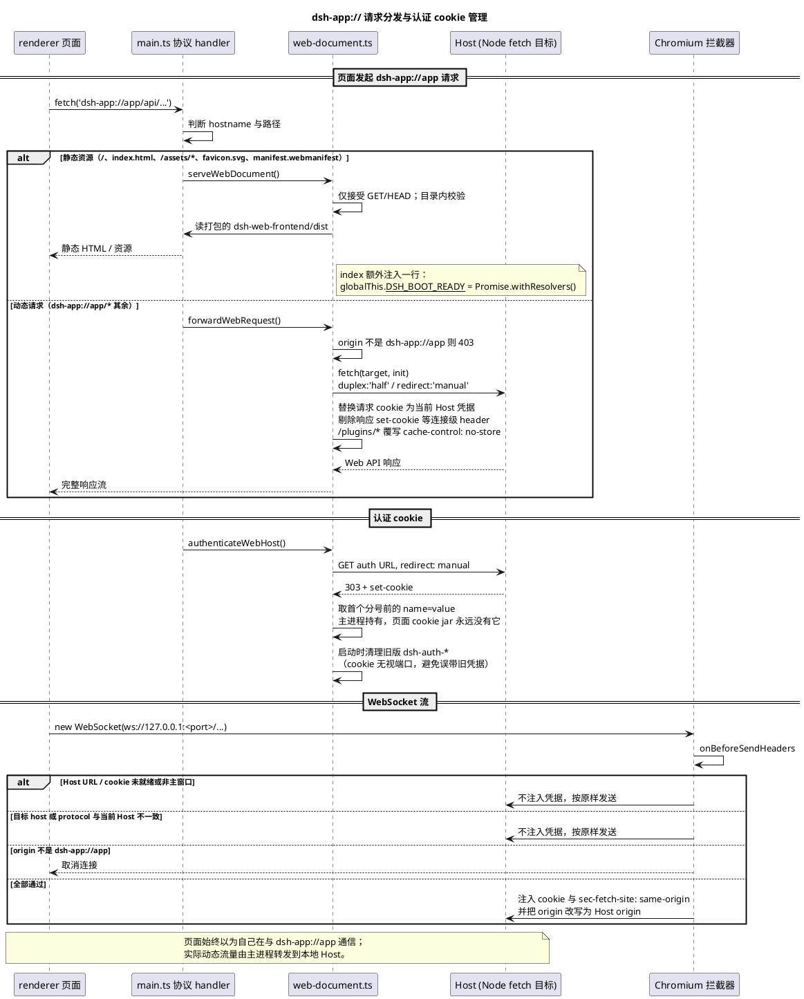
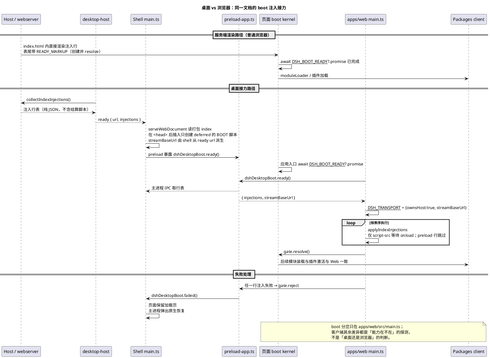
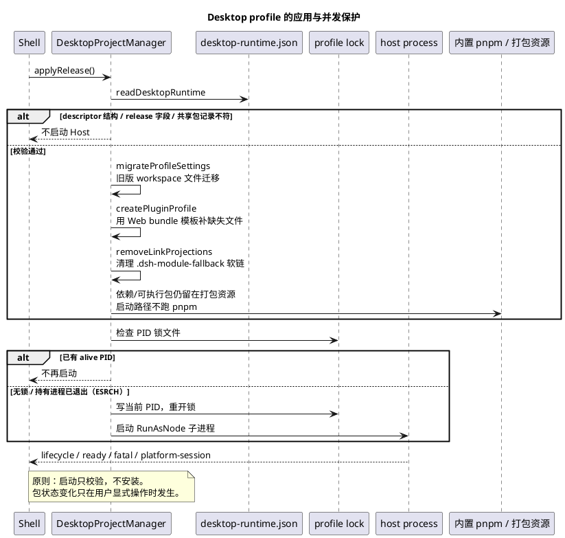
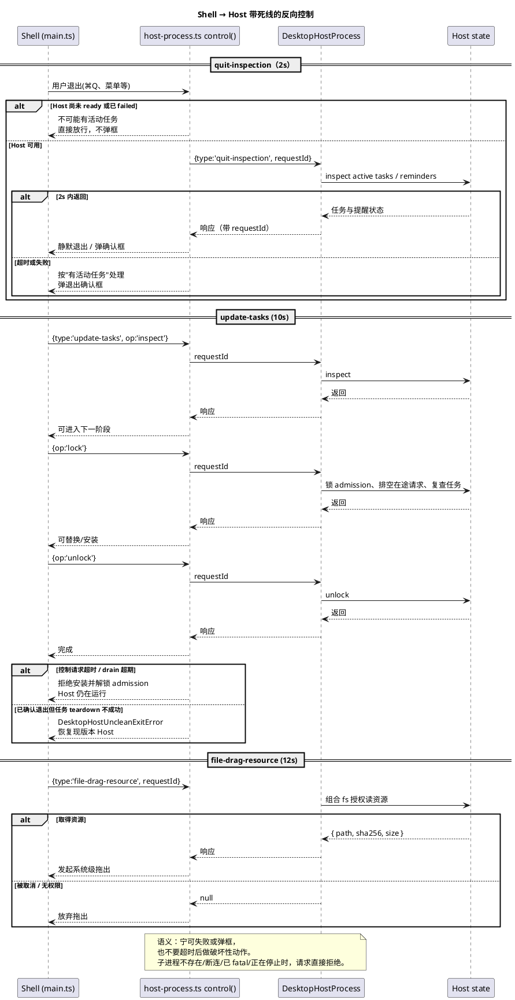

关联:[双端适配(移动端与 PC 端)](/blog/2026-11-04-dsh-dual-end-layout/)。

双击 DeepSeek Harness 图标，窗口可以先显示加载页。这时，负责会话、插件和终端的后台服务可能还在启动。等后台准备好，同一个页面就能进入应用。点「选择目录」时，它又能打开属于这个窗口的系统对话框。

这两个动作讲清了桌面适配的分工。**网页负责你看到的应用，Host 负责应用背后的业务，Electron 主进程负责窗口、启动和系统交互。** 桌面版复用了网页版的前端和 Host，再由 Electron 把它们接到桌面环境里。

## 从双击图标到选中一个目录

1. **先打开窗口。** Electron 从安装包里读出网页文件，加载页先出现。同时，它启动一个后台子进程来运行 Host。
2. **等后台准备好。** Host 启动后，把连接信息和前端启动需要的脚本清单交给 Electron 主进程。页面按顺序执行这些脚本，然后进入应用。
3. **打开系统对话框。** 你点击「选择目录」时，网页先看桌面有没有提供这个接口。有就交给 Electron 打开对话框，浏览器里则走原有的 Web 流程。

这里有个容易漏掉的细节。窗口打开的是固定地址 `dsh-app://app`，后台仍然在本机监听 HTTP 端口，默认由系统分配。Electron 主进程负责把动态请求转给当前 Host。这样，桌面版能沿用 Web 的路由、认证和流式响应。架构取舍见 桌面封装决策。

下文沿着这条启动路径看进程、请求和脚本，再展开桌面配置、原生能力、退出更新与平台差异。实现细节对应源码版本 `fcc0ad4621725`，核对记录在文末。

---

## 一、进程结构:Electron 之下跑共享 profile runner

### 先把三个"世界"分清

Electron 应用至少有两个世界:

- **主进程**:负责窗口、菜单、和操作系统打交道。
- **渲染进程**:网页代码跑的地方,默认没有 Node 权限。平时写的 TypeScript、CSS 都在这里,看不见主进程。

DSH 还多出第三个:**后台服务器**。网页版 DeepSeek Harness 需要一个 Web 服务器来跑 API、插件和流式响应;桌面版不能指望用户装了系统 Node,于是用"Electron 自己当 Node"的方式把这台服务器也拉起来。这一节讲的就是它。

```text
Electron 主进程  (apps/desktop/src/main.ts)
  └─ RunAsNode 子进程  (host-process.ts: DesktopHostProcess)
       └─ 启动脚本  (apps/desktop-host/src/index.ts)
            └─ runProfile({ profile: 'desktop', args: ['--no-open', '--host', '127.0.0.1', '--port', '0'] })
                 └─ 完整 Web composition(webserver + dsh-web-app bundle …)
```

### 三个关键点

**① Electron 可执行文件当 Node 用。** 子进程入口是打包资源里 `@deepseek-ai/dsh-desktop-host/lib/index.js`(host-process.ts:211),以 `ELECTRON_RUN_AS_NODE=1` 加 `--expose-internals` 启动。Electron 本体自带一份 Node,这个环境变量等于告诉它"这次别当窗口,当 Node 用",所以用户机器上没有 Node.js 或 pnpm 也能起后台服务。apps/desktop/README.md 的 Runtime 决策表把这条写成了硬约束。

**② Host 就是 Web runner。** desktop-host/src/index.ts 读入 profile 目录后调用 CLI 的共享 `runProfile`,profile 名为 `desktop`——这是保留名,公开 CLI 拒绝用它启动。`--port 0` 让操作系统分配端口,天然避开 Web 默认的 3080;profile 配置仍可通过 `webserver.config.port` patch 覆盖。绑定地址固定 `127.0.0.1`。

**③ IPC 是结构化消息,且在进程边界上做运行时校验。** 这里先解释两个词:

- **IPC**(进程间通信):主进程和子进程之间传消息的通道,可以理解成两个进程只用一张约定格式的信纸往来说话。
- **守卫校验**:收到消息时不直接信任,而是逐个字段检查"类型对不对、字段全不全"。进程间消息没有共享的静态类型,信任只能在运行时建立。

Host 主动上报五类主要生命周期消息:`starting`、`ready`(认证 URL + boot injections)、`fatal`(用户可见消息 + 完整诊断)、`platform-session`(嵌入 Platform 页面的凭据)、`shutdown-complete`(确认优雅停机完成)。Shell 侧用 `isDesktopHostEvent` 手写守卫逐条校验(host-process.ts:64-111);协议外的事件直接 `SIGTERM` 杀掉子进程。此外还有一类 `plugin-operation` 诊断事件会先被单独分流,不受这条"非法即杀"规则约束。

### 出错时怎么把话说清楚

`fatal` 事件把两样东西分开传:`message` 是 Host 选择给用户看的文本,`diagnostic` 是完整 inspect 过的错误(stack、可枚举属性、`cause` 链,还含 `StartupError` 的启动条目与 composition 信息),分开传输避免转义嵌套。发送在 desktop-host/src/index.ts:153,接收后包成 `DesktopHostFatalError`(host-process.ts:135-155)。stderr 另存末尾 64 Ki 字符,退出错误里一并附上。

### 进程结构图


---

## 二、传输适配:自定义协议上模拟一个"服务器"

### 为什么不用 `http://`

浏览器里访问的 URL 都是 `http://` 或 `https://` 开头。DSH 桌面版自己发明了一个开头:`dsh-app://app`。页面地址因此不再指向某个 HTTP 端口,后端每次启动换端口都不影响它。

那这个"假域名"怎么处理请求?`protocol.handle` 的作用是:**哪个 URL 来了,由我决定返回什么**。于是壳里写了一段"服务器代码",专门判断 `dsh-app://` 请求该由谁处理(main.ts:788-804):

| 请求的 URL | 去哪 | 需要 Host 吗 |
| --- | --- | --- |
| `dsh-app://shell/*` | 壳自带文件(`apps/desktop/renderer/`) | 永远不需要 |
| `dsh-app://app/`、`/index.html`、`/assets/*`、`/favicon.svg`、`/manifest.webmanifest` | 本地读打包的 `dsh-web-frontend/dist` | 不需要 |
| 其余 `dsh-app://app/*` | Node `fetch` 转发给 Host | 需要 |
| Host 还没就绪 | 直接返回 `503` | — |
| hostname 既不是 `shell` 也不是 `app` | 直接返回 `404` | — |

注意匹配的是**精确的路径/前缀白名单**,不是"看扩展名像静态资源就本地读"。

### 为什么壳要自带一份 UI 文件

`apps/desktop/renderer/` 里放着 Welcome 窗口(`welcome.html/css`)、更新对话框(`update-dialog.html/js/css`)、强制更新弹窗(`mandatory-update.html/js/css` + `-frame.js`)、策略测试登录的占位页 `policy-login-loading.html`,以及壳自己的主题变量 `shell-theme.js`。另有一个特例:`dsh-app://shell/design-platform.css` 映射到 `apps/desktop/lib/welcome/`。

分开存放的原因很直接:**更新提示、强制更新弹窗、Welcome 这些 UI,恰恰要在 Host 还没启动、已经 fatal、或正在重启的时刻显示**。如果它们也来自 Web 前端,Host 一挂,连报错的界面都出不来。所以"只要在桌面上就必须显示"的文件握在壳自己手里,真正的应用页面交给 Web 前端。

| 类别 | 什么时候可用 | 用途 |
| --- | --- | --- |
| `dsh-app://shell/*` | Host 没起来、报 fatal、正在重启时也能用 | 壳自己的 UI |
| `dsh-app://app/` 静态资源 | 启动即可读(数据接口要等 Host 就绪) | 真正的应用页面 |
| `dsh-app://app/<动态路径>` | Host 运行中 | API、RPC、插件 bundle |

### 静态资源本地读:先显示加载页

`serveWebDocument` 只接受 GET/HEAD,解码路径后做目录内校验(`..` 越界返回 403),再读文件;只在对 `/` 或 `/index.html` 的响应里,把一行引导脚本插到首个 `<head>` 开标签之后(web-document.ts:10,18-35):

```html
<script>globalThis.__DSH_BOOT_READY__ = Promise.withResolvers()</script>
```

用前端的话说:**静态资源先打包进本地,双击图标马上能看见加载页;真正的数据后端还在慢慢启动,等服务就绪、注入完成,同一个文档从加载页进入应用,全程不跳转页面**。这行脚本创建的 deferred 就是第三节的主角。

### 动态请求转发:顺手把认证闭环补上

`forwardWebRequest` 用 Node `fetch` 把请求递给 Host(web-document.ts:97-113)。页面 URL 的 pathname / search 被搬到 Host URL 上,请求头里的 `host`、`origin`、`cookie`、`sec-fetch-site` 先删掉,再塞进主进程持有的凭据:

```ts
const init = { method: request.method, headers, body: request.body, signal: request.signal, duplex: 'half', redirect: 'manual' as const }
const response = await fetch(target, init)
```

`duplex: 'half'` 保留流式请求体和取消信号,`redirect: 'manual'` 不让重定向偷偷改道。请求侧还有一道围栏:`origin` 不是 `dsh-app://app` 就直接 403。

认证闭环分三步:

| 步骤  | 做什么                                                                                                                                                              | 源码                                                                                           |
| --- | ---------------------------------------------------------------------------------------------------------------------------------------------------------------- | -------------------------------------------------------------------------------------------- |
| 拿凭据 | `authenticateWebHost` 以 `redirect: 'manual'` 请求 Host 认证 URL,确认状态是 303,取 `set-cookie` 里首个 `;` 之前的 `name=value` 整段                                                 | web-document.ts:43-50 |
| 藏凭据 | cookie 只由主进程持有;转发时替换请求的 `cookie`,响应剔除 `set-cookie` 等 11 个连接级 header(`content-encoding`、`content-length`、`transfer-encoding`、`connection` 等),页面 cookie jar 里永远没有它 | web-document.ts:78-82 |
| 清尾巴 | 启动时主动删掉历史版本留下的 `dsh-auth-*`                                                                                                                                      | web-document.ts:65-70 |

**为什么要清旧 cookie?** Host 的 cookie 名是 `dsh-auth-` 加上 authority 的哈希,而 cookie 不区分端口。Host 每次启动端口都不同,旧 cookie 却会随每次请求照样带上,直到过期——所以每次启动都要扫一遍清干净。这个动作是即发即忘的,失败只记日志,不阻塞启动。

### 两条容易被忽略的补充规则

**① 插件 bundle 强制 `no-store`。** Host 给 `/plugins/` 下的响应打的是 `immutable + 按内容派生的 revision`。对 Chromium 磁盘缓存来说,这意味着每次都可能存下一份以后再也用不上的副本,只增不减。转发时对**整个 `/plugins/` 前缀**把 `cache-control` 覆写成 `no-store`,让浏览器干脆别缓存。

> **注意：别把 revision 当成"每次启动必换"**
> 壳侧注释写的是 "changes every launch",但 Host 侧同时注明"启动与 HMR 共享 revision,未变化的产物能跨服务重启存活"。当作硬事实写进结论会过头,稳妥的说法是:**revision 会随产物内容变化,缓存没有复用保证**。

**② WebSocket 另走一条拦截。** 普通请求由主进程补 cookie,但 WebSocket 不走 `protocol.handle`。`onBeforeSendHeaders` 匹配 `ws(s)://127.0.0.1/*`,先确认 Host URL 与 cookie 已就绪、且请求来自主窗口;然后校验目标 host / protocol 与当前 Host 一致、origin 必须是 `dsh-app://app`;通过后才注入 cookie 与 `sec-fetch-site: same-origin`,并把 origin 改写为 Host 的 origin(main.ts:837-848)。

- 目标 host/protocol 对不上 → **不注入凭据,原样发送**;
- 目标对了但 origin 不符 → **直接取消连接**。

人话版:页面的 cookie jar 里没有身份,所以主进程要在请求发出前"补"上它;同时把来源改写成 Host 认得的 origin,告诉后端"这是同一来源的可信请求"。

### 请求分流图


> **提示：看图要点**
> 同一个 `dsh-app://` 协议按路径分三条路:壳自己的 UI 和应用静态资源都本地读,只有动态请求才转发给 Host;Host 未就绪时返回 503,而不是把请求丢过去。

### 传输与认证流程图



> **提示：看图要点**
> 认证 cookie 始终在主进程手里:普通请求转发时补上,WebSocket 由拦截器在发送前补上;页面的 cookie jar 里从来没有它。

---

## 三、启动适配:boot injections 的两段式接力

### 先把问题翻译成前端熟悉的话

网页版会在**服务端渲染**时把一串 `<script>`、`<style>`、全局变量插进 `index.html`。桌面版的"服务端"是后台子进程,它不能参与渲染 HTML——页面文件是壳从本地读的。但页面启动前还是需要同样的代码生效。

办法是:**把要执行的东西做成一份数据**。子进程把行表交给主进程,页面再把这份数据变回 `<script>` 插进同一个文档。所谓"两段式接力",就是第一段服务端照常整理行表,第二段桌面版把行表交给页面按行执行。

### 第一棒:Web 把注入表结构化

host/webserver/src/injections.ts 定义行类型(`placement` 只有 `'head' | 'body'` 两种):

```ts
export type IndexInjection =
  | { kind: 'global'; name: string; value: unknown }
  | { kind: 'script'; placement: IndexInjectionPlacement; text: string }
  | { kind: 'script-src'; placement: IndexInjectionPlacement; src: string }
  | { kind: 'script-preload'; src: string }
  | { kind: 'style'; text: string }
  | { kind: 'html'; placement: IndexInjectionPlacement; html: string }
```

行是纯 JSON 数据,因为**一张表要喂两种渲染器**:

| | 浏览器版(服务端渲染) | 桌面版(页面自己执行) |
| --- | --- | --- |
| 行表去向 | 渲染成 HTML 文本,head 行插在 `<head>` 后、body 行插在 `<body>` 后 | 通过 IPC 发给页面,由 `applyIndexInjections` 按表序执行 |
| 谁创建 boot deferred | 表尾的结算脚本 `??=` 创建并立刻 resolve | 第二节那行 `BOOT` 脚本在 `<head>` 后创建 |
| 谁 resolve | 表尾脚本 | 页面执行完全部行之后 |
| 表尾结算脚本 | 有 | **没有**(桌面 IPC 发的行表不含它) |

两端结算脚本长这样,对照着看最清楚:

```html
<!-- 桌面:只创建 -->
<script>globalThis.__DSH_BOOT_READY__ = Promise.withResolvers()</script>
<!-- 浏览器:创建并立即 resolve,因为行已经在文档里了 -->
<script>(globalThis.__DSH_BOOT_READY__ ??= Promise.withResolvers()).resolve()</script>
```

`global` 行承载的其实是几乎全部启动态:入口图 `__DSH_BOOT__`、模块加载器 `__ModuleLoader__`、连接恢复配置、远程访问快照,以及若干插件配置全局。所以"等注入完成"不是等几个脚本,而是等应用启动所需的整个环境就绪。

### 第二棒:桌面把它们接力过去

Host 就绪时调 `collectIndexInjections` 拿到整张表,随 `ready` 消息交给 shell(desktop-host/src/index.ts:143);preload 暴露 `dshDesktopBoot.ready()` 由页面调用(preload-app.ts:113-116);Web 入口页 apps/web/src/main.ts 接着在**同一个文档**里逐行执行:

```ts
if (desktop !== undefined) {
  const gate = (globalThis as { __DSH_BOOT_READY__?: PromiseWithResolvers<void> }).__DSH_BOOT_READY__
  if (gate === undefined) throw new Error('desktop web: boot readiness is missing')
  void desktop.ready().then(async ({ injections, streamBaseUrl }) => {
    const transport = globalThis as { __DSH_TRANSPORT__?: { ownsHost: boolean; streamBaseUrl: string } }
    transport.__DSH_TRANSPORT__ = { ownsHost: true, streamBaseUrl }
    await applyIndexInjections(injections, src => new Promise<void>((resolve, reject) => {
      const script = document.createElement('script')
      script.src = src
      script.onload = () => { resolve() }
      script.onerror = () => { reject(new Error(`desktop web: failed to load ${src}`)) }
      document.head.append(script)
    }))
    gate.resolve()
  }).catch((error: unknown) => { gate.reject(error) })
}
```

按表序执行时,**只有 `script-src` 行会等待外部脚本 `onload`**;`script-preload` 行被跳过(某些传输无法只预加载而不执行),`global` / `script` / `style` / `html` 行直接同步落地。全部行生效后才 resolve boot gate;任何一行失败,gate 转为 rejected,加载页保留,同时 `dshDesktopBoot.failed()` 通知主进程走原生恢复(main.ts:819-826)。

### 等待的一方其实很安静

packages/client/web/src/boot.ts:59 的应用入口第一行:

```ts
await (globalThis as { __DSH_BOOT_READY__?: { promise: Promise<void> } }).__DSH_BOOT_READY__?.promise
```

全局不存在,就说明这份文档没有 bootstrap 需要等,直接往下走。随后读 moduleLoader、读可选的 `__DSH_TRANSPORT__`,以相同流程激活客户端插件——**无论服务端渲染还是桌面接力,模块装载和客户端激活的代码完全一样**。

### 还有一个必须显式传的地址

boot 载荷在注入表之外还带 `streamBaseUrl`(主进程从 Host 就绪 URL 的 origin 派生),由 Web 入口写进 `__DSH_TRANSPORT__`。客户端 connection 用它解析 WebSocket 地址(client/connection/src/client/socket.ts)。

为什么不能自己算?因为页面的 `document.baseURI` 是 `dsh-app://app`,从那里解析不出 `ws://127.0.0.1:<port>`——既没有 loopback 主机,也没有端口。这个地址只能由知道 Host 在哪的一方显式传进来。`ownsHost: true` 还会把页面标记为可信的 loopback 面,不只是个 boot 字段。

> **注意：别把"不分支"说绝对了**
> 准确的说法是:**boot 流程的分岔只有 `apps/web/src/main.ts` 一处**,后续模块装载与客户端激活不区分载体。但 client 包里确实存在多处对桌面能力的存在性探测(如 `ui-settings-account` 选原生授权页还是浏览器标签、`ui-chat` 的默认 transcript 视图、`ui-settings-models` 的凭据引导、`product-analytics` 的启用条件)。它们判断的是"某个全局能力在不在",**不是"当前是不是 Electron"**——这正是第五节要讲的能力探测降级。

### Boot 注入接力图



---

## 四、Profile 所有权:独立桌面 profile,只校验、不安装

### 为什么要分家

CLI 启动和桌面启动都指向同一个 `$DSH_HOME`,但桌面专用 profile 是 `profiles/desktop`,不属于 CLI。设想一下:命令行跑着一份 npm 版,又双击打开桌面版,如果两者读同一套插件状态、争抢同一把写锁,很容易互相踩坏。

所以边界划成:**共享产品数据(会话、设置、凭据、工作区、存储),隔开可执行包、插件激活、锁文件与 `node_modules`**。apps/desktop/README.md 还写了两道保险:进程级单实例锁在访问 profile 之前就取得;公开 CLI 直接拒绝名为 `desktop` 的保留 profile(Desktop 自带的安装载体是例外,可在应用退出后管理插件)。

### 启动前的四步,一步都不装包

启动 Host 前,`DesktopProjectManager.applyRelease`(project-manager.ts:82-90)按顺序做四件事:

| 步骤 | 做什么 | 关键约束 |
| --- | --- | --- |
| `readDesktopRuntime` | 校验 `desktop-runtime.json` 的结构、release 字段与共享依赖清单,要求 dsh、desktop-host 的版本与 release 一致 | 不符则不启动 Host;平台/架构兼容、schema、shell 版本与文件完整性在**打包期**校验 |
| `migrateProfileSettings` | 把仍是旧版格式的 `pnpm-workspace.yaml` 迁移为当前格式 | 只处理识别到的旧格式 |
| `createPluginProfile` | 用 **Web 模板的 bundle 列表**初始化 profile | `initProfile` 只创建缺失文件,不覆盖既有内容 |
| `removeLinkProjections` | 清掉早期 link-backend 启动写入的 `.dsh-module-fallback` 软链投影 | 只删指向该目录的软链,其他包与软链保留 |

README 对"为什么不在启动时重新做版本比对"给了一个很克制的规定:**只有出现打包校验与实际 Host 诊断都无法充分解释的具体安装故障,才重新引入启动时版本比对**——当前选择是信任打包期校验。

**这四步刻意不跑 pnpm。** 包安装只发生在用户显式操作时:主应用(Web 页面)的 Plugins 页通过共享插件管理器发起,用的是打包资源里的内置 pnpm;Electron 主进程不提供插件管理 IPC,也没有独立的管理页面。这条原则叫"启动路径只验证,不改变包状态"。恢复路径 `disableAllPlugins` 则复用共享 `sanitizeProfile`:锁住 profile 写盘并禁用全部三方 bundle,即使 Host 起不来也能用。

### 并发保护:一把写着 PID 的锁

锁文件(project-manager.ts:92)里写当前进程号;已存在时先 `kill(pid, 0)` 探测持有者是否还活着。这个写法对前端同学容易陌生:**信号 0 不是为了杀进程,而是一个"还在不在"的探测**。没报错说明进程还活着,本次启动直接拒绝;报 `ESRCH` 说明进程已退出,才删锁重开。

### Profile 校验与锁图



---

## 五、能力桥:preload 暴露的"桌面 API 表"

### 先解释 preload

preload 是 Electron 的中间层:渲染进程看不到 Node,但能通过 preload 拿到一份**白名单**——若干由主进程特意放进页面的全局对象。安全上等价于"只开放一张窄接口"。

DSH 的用法更进一层:API 不是"必须存在"的,而是**可选的全局**。前端拿到全局后先探测"这个对象在不在",在就走桌面通道,不在就退回 Web 通道。这就是标题里的**能力探测降级**。

### 桌面 API 表与探测方

| 全局对象 | 主要消费点(存在性探测:optional chaining、`in` 或 `undefined` 判断) |
| --- | --- |
| `dshDesktop` | ui-file-actions(原生保存/剪贴板图片)、ui-file-drag(原生拖放)、shortcuts(快捷键)、ui-settings-general(更新频道/状态)、ui-settings-account(设备信息、登录方式)、ui-settings-models(凭据引导抑制)、ui-chat(默认 transcript 视图)、ui-sidebar-browser、product-analytics |
| `dshOnboarding` | ui-settings-account 的 onboarding 凭据与 Desktop 入口 |
| `dshDesktopBoot` | apps/web/src/main.ts——**boot 流程唯一分岔** |
| `__DSH_DIRECTORY_PICKER__` | ui-directory-picker-native |
| `__DSH_HOST_PATHS__` | ui-conversation 的 `@path` 文件引用 |
| `__DSH_LOCALE__` | 语言引导与变更通知 |
| `dshPlatform` | Usage / Top-up 嵌入视图 |

壳自己的窗口还有另一套独立全局:`dshWelcome`(欢迎窗口)、`dsh`(Platform 嵌入账户页)、`dshUpdateDialog`、`dshMandatoryUpdate`,它们不属于 `dshDesktop` 体系。

### 目录选择器:同一功能,按端选通道

ui-directory-picker-native/src/client/index.ts:24-42:

```ts
const desktop = (globalThis as {
  __DSH_DIRECTORY_PICKER__?: NativeFlowInjected
}).__DSH_DIRECTORY_PICKER__
const pick = desktop === undefined
  ? () => ctx.uiWorkspace.pickDirectory()   // Web: Host OS chooser
  : () => desktop.pick()                     // Desktop: Electron window-owned dialog
```

同一个入口,由"当前环境提供了哪种能力"决定走哪条路。顺带一提,Host 侧的自动选择也是一次多因子采样:除了 Linux 上缺 zenity/kdialog,远程信任、非 loopback 绑定、SSH 会话、缺图形显示,都会降级为 browse 列表交互。

### 白名单的两道身份检查

完整 `dshDesktop` API 只在 `dsh-app://app` 的**主 frame** 上暴露;其余文档(如 browser guest、shell origin 页)只拿到一个含 `protocolVersion: 1` 的空壳(preload-app.ts:128)。其余几个桥只按 protocol + hostname 暴露,并不限制主 frame。

主进程侧还有 `assertProductSender` 逐次校验窗口、sender 与 frame;boot 相关的两个 handler 用的是更宽的 `assertDesktopSender` 加手工 frame 校验。**身份检查由 preload 与 main 两层共担,不靠单点。**

### "同一份代码两用"到底指什么

所有桥都由 preload 定义,`packages/client` 下没有任何一个包 `import 'electron'`——瘦壳原则落到了依赖图上。把 client 包放进纯浏览器(dev server)跑,同一些探测全部落进 `undefined` 分支,不需要改代码。

> **注意：但别理解成"零平台知识"**
> client 包里仍有本地 `./electron/*` 模块、`dsh-app:` 协议白名单、以及针对 Electron 缺陷的 workaround。准确表述是:**不依赖 electron 包、不按载体做条件编译,只按能力全局做运行时探测**。

---

## 六、控制面:Shell → Host 的三类反向 RPC

### 方向反过来了

按下 ⌘Q 时，主进程需要知道后台还有没有任务在跑。它会发消息向 Host 查询，再决定直接退出还是弹出确认框。更新前也会用这个通道查询任务状态。

这里的 **RPC** 可以理解成"调用另一个进程里的一个函数"。既然跨进程,就不能直接调用,只能发消息并等待响应:带一个 `requestId`(唯一编号)用于配对响应,带一个死线(超时时间)避免永等。三类请求共用一个 `control()` 抽象(host-process.ts:308-339):

| 请求 | 死线 | 失败语义 |
| --- | --- | --- |
| `quit-inspection` | 2s | 请求超时或失败,按"有活动任务"处理,弹退出确认框 |
| `update-tasks`(inspect / lock / unlock) | 10s | drain 或任一步超过死线即**拒绝安装并解锁 admission**;不强行继续 |
| `file-drag-resource` | 12s | 取消随时可用;Host 异步读授权后返回 `{ path, sha256, size }` 或 `null` |

三组死线的取向一致:**宁可让控制方失败或弹框,也不要在超时后做破坏性动作**。

> **笔记：两个容易写错的边界**
> ① **"Host 未就绪"不等于"请求被拒绝"。** `control()` 的拒止条件是子进程不存在 / 断连 / 已报故障 / 正在停止,并不检查 ready。退出检查更特殊:README 明确写"尚未 ready 或已失败的 Host 不可能还在跑任务,所以退出直接放行、不弹框"。<br>② **`DesktopHostUncleanExitError` 不是超时错误。** 它来自更新交接时 `stop(requireGraceful)` 发现 Host 未优雅 teardown(已确认退出但任务 teardown 不成功),此时 Shell 会先恢复现版本 Host;控制请求超时只会让本次安装准备失败,Host 仍在运行。

这个思路的前端对照是:不要把"等得久"当成"事实已经发生了"。超时就显式告诉用户"我不确定,需要你决定",或者把这一步视为失败重来,而不是猜一个结果直接执行。

### 最小暴露:文件拖出只借不删

File drag 桥把"最小暴露"落到了具体处:Host 只用组合后的 fs 授权读取资源,返回路径、内容 sha256 和 size,**不回传文件字节**;主进程再校验准备好的文件。契约是"只借不删"——借来的文件永不删除。临时文件回收、共享的 64 MiB 配额、指针离开时释放、系统级副本 60 秒过期、取消广播等细节在 apps/desktop/README.md 有完整说明。

### 控制面时序图



---

## 七、环境差异:登录 shell、语言与平台窗口

### ① 登录 shell 环境(macOS / Linux)

先说人话:从 Finder 双击启动时,桌面版拿不到你在终端里 `~/.zshrc` 导出的环境变量(GUI 启动只继承会话管理器的环境)。这一层就是要把它们补回来。

Host 起来前,桌面按**用户数据库**(而不是 `$SHELL`)确定的登录 shell 跑一次 `<shell> -ilc`,以 `env -0` 分隔读取输出;为防止 oh-my-zsh、tmux 插件阻塞读取,探针设置 `DISABLE_AUTO_UPDATE`、`ZSH_TMUX_AUTOSTARTED`、`ZSH_TMUX_AUTOSTART=false` 等环境位。失败时依次尝试 `/bin/zsh` → `/bin/bash` → `/bin/sh`,全败则用继承环境。**Windows 跳过这一步**:注册表环境已经随 GUI 进程继承。

结果在进程生命周期内只读一次,所有 Host 共享这次探测,所以**改了 shell 配置要退出并重开应用**才生效(README "Host environment")。

### ② 语言缓存

Electron 把最近一次确认的 UI 语言缓存到 `userData/desktop/locale-cache`,启动恢复对话框在 Host settings 可用之前也能先选对语言。缓存缺失、非法或不可读时回退系统语言,写失败不阻塞启动。

### ③ 平台窗口行为

| 差异 | macOS | Windows |
| --- | --- | --- |
| 关窗语义 | 关窗→隐藏保活,Dock 图标可恢复 | 关窗→隐藏,全程保留托盘图标,首次关窗要先确认 |
| 菜单形态 | 原生菜单栏 | 40 DIP 标题栏 + 原生 popup |
| DevTools | F12 通用,另有 ⌘⌥I | F12 通用,另有 Ctrl+Shift+I |

这些差异都实现在 Electron 内,**不下沉到页面代码**:Web 页面相同,窗口语义不同。

---

## 收束:三条不变量

把七层合起来,可以提炼成三条架构承诺:

1. **复用,不复制。** 凡 Web 已有的(认证、路由、流、插件管理、boot 页)一律复用;桌面专属代码只出现在接触面(协议 handler、IPC 消息、preload 桥)。代价是桌面仍要监听一个本地端口,收益是 Web 行为升级随同一版本号一起发布,桌面无需另写一遍。
2. **同一文档内引导。** 桌面和 Web 跑在同一个 `index.html`;差异在 boot gate 结算之前的注入阶段消除。`__DSH_BOOT_READY__` 是唯一的同步点。
3. **能力探测降级,而非条件编译。** 桌面桥是可选全局,客户端逐点探测;探测为空即回退 Web 行为,同一份 client 代码维持两种运行态。preload 空壳兜底 + 主进程二次校验,让身份检查不只靠 preload 一层。

此前的[双端适配笔记](/blog/2026-11-04-dsh-dual-end-layout/)看的是"同一套 UI 怎么装进不同屏幕"(信号 → 断点 / 输入 / 焦点 / 状态);本篇看的是"同一个 Web 应用怎么搬进原生窗口"(共享 runner → 协议转发 → 注入接力 → 能力桥)。两篇合起来是同一件事的两环:**界面随空间适配,壳随平台适配**。

## 附:源码校验说明

本文按本地仓库 `fcc0ad462172522aaf5c93a7b2e01f6b9f0b0159` 逐条复核(2026-11-11)。主体结论全部成立,以下表述按源码收紧,避免读者据二手转述产生误解:

| 位置 | 收紧内容 |
| --- | --- |
| 第一节 | `fatal` 的 message / diagnostic 发送方在 `desktop-host/src/index.ts:153`,`host-process.ts:135-155` 是 `DesktopHostFatalError` 类定义;stderr 上限为 64 Ki **字符**;另有 `plugin-operation` 事件先于守卫被分流 |
| 第二节 | 静态资源是精确路径白名单(`/`、`/index.html`、`/assets/*`、`/favicon.svg`、`/manifest.webmanifest`),另有 503 / 404 出口;登录占位页实为 `policy-login-loading.html`;`authenticateWebHost` 取的是 `set-cookie` 首个分号前的整段 `name=value`;插件 revision 与内容绑定,不宜断言"每次启动必换" |
| 第三节 | 只有 `script-src` 行等待外部脚本加载,`script-preload` 跳过;「客户端代码完全不分支」改为「boot 分岔仅一处,其余为能力存在性探测」 |
| 第四节 | 插件安装入口是**主应用(Web)的 Plugins 页**,不是 Electron 主进程;内置 pnpm 位于外部 runtime resources,不是签名资源 |
| 第五节 | 凭据引导抑制归 `ui-settings-models` 而非 `ui-settings-account`;`dshOnboarding` 的消费点是 onboarding 凭据而非独立 welcome 窗口(后者用 `dshWelcome`);boot 类 IPC 用 `assertDesktopSender` |
| 第六节 | `control()` 不检查 ready;Host 未就绪时退出直接放行;`DesktopHostUncleanExitError` 来自非优雅 teardown 而非控制超时 |
| 收束 | 「放弃 portless 传输换来的收益」改为明示代价(仍监听本地端口)与收益(复用 Web),且不宣称性能收益 |

## 参照顺序(若要回到代码印证)

1. 2026-09-10-desktop-web-wrapper:总决策与被否掉的备选。
2. apps/desktop/README.md:用户侧完整契约,尤其 Application overview、Closing the window、Installation ownership 与 Host environment 四节。
3. host-process.ts + desktop-host/src/index.ts:父子进程与 IPC 协议。
4. web-document.ts + main.ts 协议 handler:传输与认证。
5. injections.ts + preload-app.ts + 各 client 包探测点:注入接力与能力桥。
6. project-manager.ts:profile 所有权与锁。
7. 2026-09-08-desktop-bundled-runtime-and-external-plugins:runtime 与包所有权;打包、签名、发布另见 apps/desktop 下三份指南。
