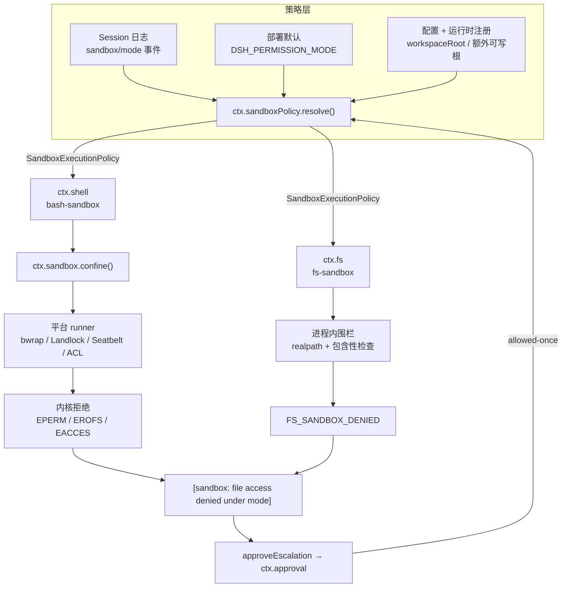
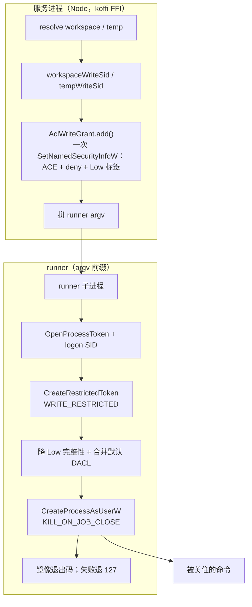
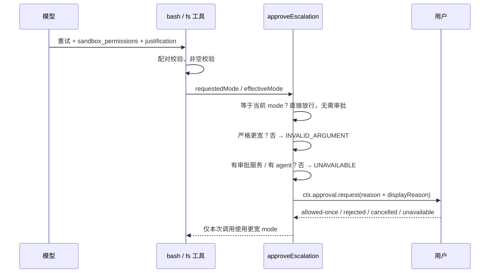

模型要写一个工作区外的文件，或者跑一条会删目录的命令，DSH 到底在哪一层拦住它？

读完 `packages/sandbox` 和两侧的消费者，能看出 DSH 的沙箱不是一个开关，而是**两层职责不同、却共用一套策略词汇**的机制：一层把子进程交给内核去关，另一层在进程内检查模型给出的路径。两层都从同一个 `ctx.sandboxPolicy` 取 `mode` 和 `workspaceRoot`，用同一句拒绝提示、同一条升级阶梯。

| 层 | 实现 | 强度 | 管什么 |
| --- | --- | --- | --- |
| 进程沙箱 | `ctx.sandbox` + `sandbox-local` 后端 | 内核级（bwrap / Landlock / Seatbelt / Windows ACL 受限令牌） | `bash`、pwsh、持久终端、PTC 子进程的文件效果 |
| 文件沙箱 | `ctx.fs` + `fs-sandbox` 后端 | 进程内策略围栏，不是内核边界 | `write` / `edit` / `patch` / `delete` / `move` 的目标路径 |
| 策略中心 | `ctx.sandboxPolicy` | 无强制力，只解析策略 | 默认 mode、会话覆盖、workspace root、额外可写根 |

**内核关住代码，围栏拦住路径；两层都不管网络。**

---

## 一、为什么是两层，而不是一个开关

两层对应两种威胁模型。

`bash` 执行的是模型写出来的任意代码，它会 `fork`、会调用编译器、会跑 `curl`。对这种「不可信代码」，更可靠的办法是让内核在系统调用层面拒绝——`bwrap` 的只读挂载、Landlock 的访问权、Seatbelt 的 SBPL 策略、Windows 的受限令牌，都是这一类。

而 `write` / `edit` 这些文件工具不是任意代码。它们的操作是 DSH 自己的 `open`、`rename`，**不可信的只有目标路径**。既然操作本身可信，进程内「先 canonicalize 再判包含」就是完整答案，不需要再起一个受内核约束的子进程。

这个分工在源码里写得很直白：

> The fence is a policy check in TRUSTED code over a MODEL-CONTROLLED path, NOT a kernel boundary — the operations are the seam's own (open, rename), and only the target path is untrusted, so canonicalize-then-contain is the complete answer to this surface. This is containment, not a security boundary; kernel-grade isolation of untrusted CODE stays `ctx.shell`'s job.
>
> —— `fs-sandbox/src/index.ts:10-18`

数据流是这样的：



---

## 二、策略中心：`mode` 和 `root` 的唯一真相

每次能力调用都先解析一份完整的策略。核心只有这几行（`sandbox-policy/src/index.ts:212-224`）：

```ts
return {
  mode: request.mode ?? (session === undefined ? undefined : this.overrideOf(session)) ?? this.defaultMode,
  workspaceRoot: this.sessionWorkspaceRoot(session),
  ...additionalWritableRoots === undefined ? {} : { additionalWritableRoots },
  ...session === undefined ? {} : { sessionId: session.id },
}
```

**mode 是三级优先**：显式审批覆盖 > 会话最后一次 `sandbox/mode` 事件 > 部署默认。

- 部署默认在 base bundle 里是 `process.env.DSH_PERMISSION_MODE ?? 'workspace-write'`（`base/cordis.patch.yml:237-247`），而包内 schema 的默认值是 `'read-only'`（`sandbox-policy/src/index.ts:139-145`）。**没有配置时取最保守值**，不是最宽松值。
- 会话覆盖就是一条日志事件。`setSandboxMode()` 只做一件事：`session.append('sandbox/mode', { mode })`（`session-mode.ts:53-55`）。没有外部配置存储，重启靠 replay 恢复，两个会话互不可见。
- 读取侧是一个 projection：`key: 'sandboxMode'`，`apply` 只认 `sandbox/mode`（`sandbox-policy/src/index.ts:176-182`）。

**root 是会话的不可变 cwd**，配置里的 `workspaceRoot` 只是「无会话 / 无 cwd」时的兜底。相对路径或含 NUL 字节直接抛 `SANDBOX_INVALID_ROOT`（`sandbox-policy/src/index.ts:234-237`）。

**额外可写根是运行时注册**，不落盘：

```ts
registerWritableRoot(session: Session, directory: string): () => void
```

它用 `WeakMap<Session, Map<symbol, string>>` 存，dispose 只摘自己那一条（`sandbox-policy/src/index.ts:252-269`）。所以 resume / fork 之后必须重新注册——注释里明确写了 "Grants are runtime-only and must be registered again after resume or fork."

这份策略还会以 `sandbox:policy` 上下文注入系统提示（`sandbox-policy/src/index.ts:184-195`）。你看到的那句 `Current DSH file policy: workspace-write...` 就是它渲染的：它告诉模型当前边界，但不替模型做判断——注释要求模型「照常尝试，然后按工具返回的拒绝和升级提示走」。

---

## 三、进程沙箱：`confine()` 的四元组契约

`sandbox/src/index.ts:201-226` 只暴露一个抽象方法：

```ts
abstract confine(argv: readonly string[], policy: SandboxPolicy, signal?: AbortSignal): Promise<ConfinedArgv>
```

几个设计要点都写在类型注释里：

1. **策略随调用走，不固定在 provider 上。** `SandboxPolicy` 是每次调用的入参。同一时刻，bash 可以在 `read-only` 下跑，而一个被限制的子 agent 需要写自己的状态目录——两者互不影响。审批升级也是一次「更宽策略的新调用」，不需要改 provider 状态。
2. **`danger-full-access` 根本不会进 provider。** 消费者自己 spawn 原 argv，例如 `bash-sandbox/src/index.ts:89-97` 的第一个分支。
3. **返回值是四元组**（`sandbox/src/index.ts:107-133`）：

| 字段 | 作用 |
| --- | --- |
| `argv` | runner + profile + `--` + 原 argv，消费者直接 spawn 它 |
| `enforcement` | `full` / `partial`，本后端对这份策略的执法完整度 |
| `denialSignatures` | 本后端拒绝时 stderr 的方言（bwrap 的 `read-only file system`、Landlock 的 `permission denied`、Seatbelt 的 `operation not permitted`） |
| `runnerFailureRules` | runner 在执行命令**之前**就失败的证据规则（签名 + 退出码门 + 可忽略的信息行） |

4. **失败关闭。** 没有可用后端就抛 `SandboxUnavailableError`（`SANDBOX_UNAVAILABLE`），文本明确写 "refusing to run the command unconfined"；准备宿主状态失败抛 `SandboxPreparationError`。**静默放行是非法的**——抽象类的注释原话是 "silent unconfined passthrough is forbidden"。

错误码可以对照这张表：

| 错误码 | 含义 | 谁抛 |
| --- | --- | --- |
| `SANDBOX_UNAVAILABLE` | 没有可用后端，命令没跑 | provider / 消费者分类 runner 失败后 |
| `SANDBOX_PREPARATION_FAILED` | 准备宿主状态失败（ACL、私有 temp 目录） | Windows ACL 后端 |
| `SANDBOX_INVALID_TEMP_ROOT` | temp 根落在 workspace 内，私有 temp 会继承 workspace 授权 | Windows ACL 后端 |
| `SANDBOX_INVALID_ROOT` | 会话 cwd 或额外可写根不可执行（相对路径、NUL、缺失、符号链接） | 策略中心 / roots 推导 |
| `SANDBOX_ESCALATION_*` | 升级请求非法、无审批通道、被拒、被取消 | 升级编排 |
| `FS_SANDBOX_DENIED` | 文件围栏拒绝了一次 mutation | `fs-sandbox` |

---

## 四、四个包各管一段

`packages/sandbox` 是一个包组，不是一个包。四个包分工很清楚：一个只定义词汇，一个知道本机怎么关进程，一个只决定这次用哪个 mode，最后一个把 Windows 的写权限真正做出来。

| 包 | 在 `ctx` 上的位置 | 负责 | 不负责 |
| --- | --- | --- | --- |
| `sandbox/` | `ctx.sandbox`（抽象类） | 词汇、契约、错误码、升级阶梯、可写根推导、stderr 分类 | 任何平台细节 |
| `sandbox-local/` | 实现并注册 `ctx.sandbox` | 选 runner、拼 profile、Windows 授权生命周期、方言表 | 策略优先级（向 `ctx.sandboxPolicy` 要） |
| `sandbox-policy/` | `ctx.sandboxPolicy` | 部署默认、会话覆盖、workspace root、额外可写根、模型可见策略 | 强制力 |
| `sandbox-windows-acl/` | 不注册服务，被 `sandbox-local` 挂成 win32 后端 | 受限令牌、DACL/标签、runner、FFI、诊断技能 | 平台选择、读策略 |

### 4.1 `sandbox/`：定义「什么叫关住了」

五个源文件，全是词汇与判定，没有一行会去启动进程：

- **`index.ts`** —— `SandboxProvider` 抽象类，唯一方法是 `confine()`；`SandboxMode` / `SandboxEnforcement` / `SandboxExecutionPolicy` / `SandboxPolicy` / `ConfinedArgv` / `RunnerFailureRule` 这六个核心类型；`SandboxUnavailableError`（`SANDBOX_UNAVAILABLE`）与 `SandboxPreparationError`（`SANDBOX_PREPARATION_FAILED` / `SANDBOX_INVALID_TEMP_ROOT`）。
- **`escalation.ts`** —— 严格更宽阶梯、两行固定话术、`approveEscalation()` 的审批编排。
- **`roots.ts`** —— `canonicalPath()`、`workspaceWritableRoots()`（workspace + 额外根）、`writableRoots()`（再加 `/tmp` 与 `os.tmpdir()`）、`SandboxInvalidRootError`。**同一个文件同时喂给 Seatbelt profile 和 fs 围栏**，所以两边的可写集合不会漂移。
- **`diagnostics.ts`** —— `classifyRunnerFailure()` 按「非零退出 → 退出码门 → 排除信息行 → 匹配 fatal 签名」判 runner 失败；`matchesSignature()` 判拒绝；`isRunnerSpawnFailure()` 只认 `argv[0]` 自身的 `ENOENT` / `EACCES`。
- **`locales.ts`** —— 拒绝与升级话术的中英日文案。

它只依赖 `dsh-util-values`，所以任何平台后端都能只依赖词汇，不被别的后端拖进来。

### 4.2 `sandbox-local/`：唯一知道「这台机器怎么关」的包

它是 `ctx.sandbox` 的实现，也是选择链、探针、profile、Windows 授权的共同住址。三个配置项（`runnerCommand`、`runnerFailureSignatures`、`probeTimeoutMs`）都在这里。它做四件事：

1. **选 runner 并缓存**：按 `process.platform` 取链，单候选不探针，多候选按序探针，结果存在 `selectedRunner` 里直到插件重载；没有链或全失败 → `SandboxUnavailableError`。
2. **拼 profile**：`profiles.ts` 三个函数对应 bwrap / Landlock / Seatbelt；Windows 的「profile」不是字符串，而是一串 `--workspace/--temp/--mode` 参数（见 5.6）。
3. **持有 Windows 授权**：`workspaceGrants` 按 workspace 缓存常驻 ACE；`tempCapabilities` 按 `[sessionId, workspaceRoot]` 缓存可撤销的私有 temp。provider 销毁时撤销 temp 授权、删掉目录，常驻 workspace ACE 留着。
4. **兜底入口**：`windowsAclRunnerInvocation()` 先找构建好的 `lib/runner.js`，找不到就退回 `src/runner.ts` + `tsx` 加载器，并把 `tsconfig` 路径锚定到本次安装——目标 cwd 和环境变量不能改写 runner 的依赖解析。

`runnerCommand` 是运维断言：一旦配置，就跳过探针、直接声明 `full`，并且必须同时给 `runnerFailureSignatures`（构造期校验，缺一报错）。

### 4.3 `sandbox-policy/`：只回答「这次用哪个 mode、哪个 root」

两个源文件，全部是解析与投影：

- `resolve()`（`index.ts:212-224`）把三级优先、root 回退、额外根合并成一份 `SandboxExecutionPolicy`；
- `session-mode.ts` 定义 `sandbox/mode` 事件、它的 fold 和写路径；`index.ts` 注册 `sandboxMode` projection 与 `sandbox:policy` 提示段。

它没有任何强制力：不 spawn、不开文件、不判路径存在性。物理校验留给执行侧——`additionalRoot()` 的 realpath、Windows 的 `assertPrivateTempDisjoint()`。

### 4.4 `sandbox-windows-acl/`：把 Win32 写权限「做出来」的包

十一个源文件，各管一层：

| 文件 | 职责 |
| --- | --- |
| `index.ts` | `AclSandbox`：`init()` 建令牌与授权、`spawn()`、`dispose()` 撤销 |
| `token.ts` | `OpenProcessToken` → logon SID → `CreateRestrictedToken` → Low 完整性 → 默认 DACL 合并 |
| `acl.ts` | `grantWrite()` / `revokeWrite()`：一次 `SetNamedSecurityInfoW` 写三处，每路径 `LockFileEx` 串行化，精确 ACE 命中即跳过 |
| `grant.ts` | `AclWriteGrant`：常驻与可撤销路径的记账、SID 释放 |
| `runner.ts` | argv 前缀进程：建令牌、spawn、镜像退出码，失败打 `windows-acl-run: ` 并退 127 |
| `spawn.ts` | 复用 `dsh-win32-process` 的受限进程与 Job 原语 |
| `ffi.ts` / `win32-abi.ts` | koffi 绑定表与常量；`verify/abi-probe.cpp` 对着 Windows 头文件核对结构体布局 |
| `workspace-sid.ts` | `S-1-4-x-y` 派生（见 5.6） |
| `path-boundary.ts` | temp 与 workspace、temp 与可写根的相互包含拒绝 |
| `acl-skill.ts` | 把 `diagnose-windows-sandbox-acl` 技能注册进技能表 |

### 4.5 装配：谁把它们挂起来

`bundle/base` 把四者挂在同一条链上（`base/cordis.patch.yml:246-262`、`:551-554`）：`sandbox-local` 提供 `ctx.sandbox`，`sandbox-policy` 提供 `ctx.sandboxPolicy`，`bash-sandbox` / `pwsh-sandbox` 是 `ctx.shell` 的受限执行器，`fs-sandbox` 是 `ctx.fs` 的受限实现。

`sandbox-windows-acl` 不出现在这份装配里——`sandbox-local` 是唯一在运行时 import 它的包，把它当 win32 后端挂载。组外还有一个消费者值得点名：`packages/fs/fs-sandbox` 不属于这个包组，但它是同一份策略的另一侧（第六节）。

---

## 五、四个平台的底层实现

### 5.1 共同形状：runner 前缀 + profile + `--` + 原 argv

`confine()` 的返回永远是同一个形状：

```
[<runner>, ...<profile>, '--', ...<原来的 argv>]
```

`<profile>` 把「mode + root + 额外根」翻译成本平台原语，`--` 之后原样透传。四家的差别只在用什么原语，而「要表达的意思」只有两种：拒绝一切写（`read-only`），或在 workspace 与显式额外根下允许写（`workspace-write`）。生成 profile 前，provider 会先把 root 交给 `canonicalPath()`（`sandbox-local/src/index.ts:345`）。

| 平台 | 内核原语 | 拒绝写时的 errno |
| --- | --- | --- |
| Linux · bwrap | mount namespace 的只读绑定 | `EROFS`（`read-only file system`） |
| Linux · Landlock | LSM 的访问权 allow-list | `EACCES`（`permission denied`） |
| macOS · Seatbelt | MACF 策略（SBPL） | `EPERM`（`operation not permitted`） |
| Windows · ACL | 受限令牌 + DACL + 完整性标签 | `ERROR_ACCESS_DENIED`（`Access is denied` 等） |

方言表不是随便写的：每种拒绝的文本，就是各自内核拦下写操作时给出的那个 errno。

### 5.2 选择链：先按平台，再按探针

`sandbox-local/src/index.ts:178-185`：

```ts
const PLATFORM_CHAINS = {
  linux: ['bwrap', 'landlock'],
  darwin: ['seatbelt'],
  win32: ['windows-acl'],
}
```

- **只有一个候选就不探针**（darwin / win32），直接选；运行时拒绝仍走失败关闭。
- **多个候选按序做功能性探针**：bwrap 真的用只读 profile 跑一次 `true`，Landlock 由 launcher 的 `probe()` 返回 `full` / `partial` / `unusable`。
- 结果缓存在 provider 生命周期内（`selectedRunner`），所以装 / 卸 runner 要重载插件才生效。
- 探针超时必须是正有限数：Node 把 `spawnSync({ timeout: 0 })` 当作**没有超时**，不校验就会把「5 秒探针」变成「无限等待」（`sandbox-local/src/index.ts:209-218`）。

### 5.3 Linux：bwrap 只改「看得见的文件系统」

profile 只有五种设置、两种形状（`profiles.ts:16-23`）：

```ts
['--ro-bind', '/', '/', '--dev', '/dev', '--unshare-pid', '--proc', '/proc', '--die-with-parent']
// workspace-write 追加
['--tmpfs', '/tmp', ...每个可写根 '--bind', root, root]
```

逐条看：

- `--ro-bind / /` 把宿主根整个以只读方式挂进新 mount namespace。写是 `EROFS`，跟文件权限位无关，`chmod` 也改不了。
- `--dev /dev` 给一个全新的 `/dev`；`--proc /proc` 在 `--unshare-pid` 之后挂 procfs，于是命令能管自己的后代、看不到宿主进程。
- `--die-with-parent` 让 bwrap 随父进程退出，避免子进程被留在外面。
- `workspace-write` 用 `--tmpfs /tmp` 给一块一次性可写 `/tmp`，再对 workspace 和每个额外根做 `--bind root root`。
- profile 里没有 `--unshare-net`，所以网络出口完全没动——和「策略词汇只有文件效果」一致。

探针是**真的跑一次**：`bwrap <read-only profile> -- true`，`status === 0` 才算可用（`sandbox-local/src/index.ts:87-93`）。只 `which bwrap` 会骗人：二进制在，但内核策略可能不让它建命名空间。

### 5.4 Linux：Landlock 只加「能做什么」

Landlock 不提供只读挂载，它给进程一组不可再放宽的访问权。provider 只负责把 mode 翻译成 launcher 的 grant 参数（`profiles.ts:30-36`）：

```ts
landlockGrantArgs({ readOnly: ['/'], readWrite: ['/dev/null'] })
// workspace-write：readWrite 追加 '/tmp' 与每个可写根
```

真正的规则装配在 `landlock-run` 里——那是 `@deepseek-ai/node-addon-system` 提供的独立可执行文件，随 npm 包按平台分发二进制，不在这个仓库里。分工因此很干净：**路径解析、grant 词表、探针解析都随二进制的版本走，provider 只映射 mode**。

探针返回三值 `full` / `partial` / `unusable`（`sandbox-local/src/index.ts:579-582`），因为老内核的 ABI 只覆盖它暴露的访问类别。失败约定是退出码 125 + `landlock-run: ` 前缀；每次运行还会打一行 `landlock-run: partial enforcement (older Landlock ABI)`，这行在匹配 fatal 签名前按整行排除（`informationalLines`）。

### 5.5 macOS：Seatbelt 的 SBPL，只写不读

profile 是四个固定形式加每个根一条 `subpath`（`profiles.ts:53-59`）：

```scheme
(version 1)(allow default)(deny file-write*)
(allow file-write* (literal "/dev/null"))
(allow file-write* (subpath "~/workspace") ...)
```

- `(allow default)` 先放行一切，然后只掐 `file-write*`——读、网络、进程可见性都不在边界内。
- 可写根来自共享的 `writableRoots()`（workspace + 额外根 + `/tmp` + `os.tmpdir()`），而且必须 canonical：macOS 上 `/tmp` 就是 `/private/tmp`，照配置原文写一条都匹配不上。
- 执行者是系统自带的 `sandbox-exec -p <profile>`，走 `sandbox_init`。Apple 标了 deprecated 但每个 macOS 都还在；探针拿真实 profile 跑一次 `true`（`sandbox-local/src/index.ts:104-110`），哪天它真消失，这里会先失败关闭。

### 5.6 Windows：一个进程做不了，所以拆成「服务 + runner」

Windows 没有「只读挂载」这种东西。要限制写，得同时动三样：**令牌**（谁能写）、**DACL**（这个目录允许谁写）、**完整性标签**（低完整性进程能不能写这个对象）。令牌与 DACL 必须在 spawn 之前备好，所以这个后端是两段式：



**第一步：派生身份。** workspace 的写 SID 是 `S-1-4-x-y`，两个子权威取自 `sha256(canonical workspace path)`（`workspace-sid.ts:35-40`）；temp 的 SID 多一个固定子权威 `…-1`，哈希输入是 `'temp\0' + 私有 temp 路径`（`:49-54`）。于是同一 workspace 的所有会话、重启、调用共享一个写 SID（ACE 只物化一次），而每个会话的私有 temp 身份互不相同。

**第二步：把授权写进目录。** `grantWrite()` 只发一次 `SetNamedSecurityInfoW`，同时落三处编辑（`acl.ts:377-414`）：

1. capability SID 的 Allow ACE，掩码 `GRANT_MASK = (FILE_GENERIC_WRITE | DELETE | FILE_DELETE_CHILD) & ~STANDARD_RIGHTS_WRITE`，显示为「修改」；
2. 给 Everyone 的 **Deny** `FILE_DELETE_CHILD`（只继承到子目录）——因为 Windows 还能凭父目录的删除子项权限授权删除，而那个权限不经过 restricting SID 的交集检查；
3. Low 强制性标签（`SYSTEM_MANDATORY_LABEL_NO_WRITE_UP`），让低完整性令牌能写这块目录。

「读 DACL → 合并 → 写回」整段在一条 per-path 排他锁里（`<GetTempPathW()>\dsh-acl-locks\<sha256(path)[0:16]>.lock` + `LockFileEx`），并发实例不会互相覆盖 ACE。若 ACE、deny、标签三者都已精确存在，直接跳过——否则每次 `SetNamedSecurityInfoW` 都会把整棵树重新继承传播一遍，大仓库上以分钟计。

**第三步：造受限令牌。** `init()` 从头到尾失败关闭（`index.ts:225-346`、`token.ts:216-243`）：

- 打开当前进程令牌（`TOKEN_QUERY | TOKEN_DUPLICATE | TOKEN_ADJUST_DEFAULT | TOKEN_ASSIGN_PRIMARY`），从 `TokenGroups` 里挑带 `SE_GROUP_LOGON_ID` 的 logon SID；
- `CreateRestrictedToken(..., DISABLE_MAX_PRIVILEGE | WRITE_RESTRICTED)`，restricting 列表随 mode 变：`read-only` 是 `[logon SID, Everyone]`，`workspace-write` 再加 `[workspace SID, temp SID]`；
- 令牌降到 Low 完整性（`S-1-16-4096`）；
- 往令牌的默认 DACL 补一条 restricting SID 的完全访问 ACE。不补的话，被关住的进程连匿名管道都建不出来（新对象的 DACL 里没有 restricting SID，pass-2 直接拒），所有「管道 stdio 的子进程」都会 `EPERM`。

`logon SID + Everyone` 是保活组：缺了它，早期 DLL 初始化会以 `0xC0000142` 死掉，CNG 会让 pwsh 崩在 `0xE0434352`。列表里同时**刻意缺席**了 Authenticated Users（WMI/CIM 检查失败，CIM cmdlet 不可用，也关掉 `C:\` 根下建目录的逃逸）和 INTERACTIVE/LOCAL（宿主 Public 树对 INTERACTIVE 可写）。

**第四步：写检查是四道门。** 任何一道不过就是 `ACCESS_DENIED`：


**第五步：spawn 与收尾。** runner 用 `CreateProcessAsUserW` 以受限令牌起子进程（复用 `dsh-win32-process`），把子进程放进 `KILL_ON_JOB_CLOSE` 的 Job（父死子死），把 `TMP`/`TEMP` 改写成私有 temp 目录，然后镜像子进程的退出码（32 位全宽，`0xC0000005` 这类 NTSTATUS 原样回传）。ACL 由服务侧物化，runner 只拿 `--write-sid` / `--temp-write-sid` 与路径对账，自己不授予（`manageDacls: false`）。任何 runner 侧失败都打 `windows-acl-run: <detail>` 并退 127，由方言表判成「沙箱坏了」而不是「命令被拒」。`dispose()` 只撤 temp 授权（常驻 workspace ACE 留着当复用缓存），并把每个失败聚合进 `AggregateError`。

**为什么上报 `partial`。** 三件事这个机制做不到：NTFS 硬链接让同一个文件对象在授权路径之外也有名字；读完全不受限（`WRITE_RESTRICTED` 只交写类访问）；某个目录若被别的 AppContainer 工具用 package SID ACL 过，低完整性令牌读不到它。所以它把「写边界」如实报成 `partial`，不说成隔离。

### 5.7 `full` 和 `partial` 是上报事实，不是承诺

`sandbox-local/src/index.ts:187-207`：

| 后端 | enforcement | 原因 |
| --- | --- | --- |
| bwrap | `full` | 只读挂载 + 显式 bind，构造上覆盖全部承诺的文件效果 |
| Seatbelt | `full` | `deny file-write*` + 白名单，同上 |
| Landlock | `full` / `partial` | 老内核 ABI 只覆盖它暴露的访问类别，launcher 每次运行还会在 stderr 自报 partial |
| Windows ACL | `partial` | NTFS 硬链接把同一文件对象别名到授权路径之外；读不受限；被别的 AppContainer 工具 ACL 过的目录，Low 完整性子进程读不到 |

消费者如果要求绝对边界，必须拒绝或显式呈现 `partial`，不能把 `partial` 当 `full` 用。

### 5.8 拒绝方言与 runner 失败规则

这是整个设计里最实用的部分：**「沙箱坏了」和「命令被拒」必须分开**。

`sandbox-local/src/index.ts:225-260` 给每个后端配了两组字符串：

```ts
const DENIAL_SIGNATURES = {
  bwrap: ['read-only file system'],
  landlock: ['permission denied'],
  seatbelt: ['operation not permitted'],
  'windows-acl': ['access is denied', 'access to the path', 'permission denied', 'operation not permitted'],
}

const RUNNER_FAILURE_RULES = {
  bwrap: [{ fatalSignatures: ['bwrap: '] }],
  landlock: [{ allowedExitCodes: [125], fatalSignatures: ['landlock-run: '], informationalLines: [...] }],
  seatbelt: [{ fatalSignatures: ['sandbox-exec: '] }],
  'windows-acl': [{ allowedExitCodes: [127], fatalSignatures: ['windows-acl-run: '] }],
}
```

分类顺序不能反：先查 `runnerFailureRules`（runner 在命令执行前失败 → 抛 `SANDBOX_UNAVAILABLE`），再查 `denialSignatures`（命令跑了，被策略拒绝 → `denied: true`）。因为 runner 失败意味着**命令根本没跑**，把它报成「命令失败」会让模型去改命令，而不是去修沙箱。

`informationalLines` 的存在是为了防误报：Landlock launcher 每次运行都会打一行 `partial enforcement (older Landlock ABI)`，这是信息，不是失败，必须在匹配 fatal 签名前按整行精确排除。

### 5.9 同一份策略，四种 temp 语义

| mode | bwrap | Landlock | Seatbelt | Windows ACL |
| --- | --- | --- | --- | --- |
| `read-only` | `/tmp` 随只读挂载一起被关 | 只放 `/dev/null` | 只放 `/dev/null` | 不给任何显式根 |
| `workspace-write` | `--tmpfs /tmp` | `/tmp` + 可写根 | `/tmp` + `os.tmpdir()` + 可写根 | workspace + 每会话私有 temp |

Windows 那一格是唯一一处语义分叉：它的额外可写根只改变 `write` / `edit` 工具，不改 PowerShell、终端、PTC 子进程的 ACL。

---

## 六、文件沙箱：一个进程内的围栏

`SandboxedFileSystem` 继承 `LocalFileSystem`，只重写五个 mutation：`writeText` / `editText` / `patchText` / `deleteFile` / `moveFile`。读操作完全不拦——任何 mode 都允许读。

核心是 `fs-sandbox/src/index.ts:156-178`：

```ts
if (mode === 'danger-full-access') return target
if (mode === 'read-only') throw new FsError(..., 'FS_SANDBOX_DENIED')
const fresh = await this.resolve(target.displayPath)   // 立刻重新 realpath
for (const root of writableRoots(policy)) {
  if (await isPathUnder(fresh.targetKey, root)) contained = true
}
if (!contained) throw new FsError(..., 'FS_SANDBOX_DENIED')
return fresh   // 用刚检查过的身份去写，避免 check-here-write-there
```

三个关键点：

1. **`moveFile` 先检查两端**，源和目标都通过才执行（`fs-sandbox/src/index.ts:136-143`）。拒绝时两个文件都没动。
2. **写入用的是「刚检查过的那个 target」**，不是调用方传进来的旧值。`resolve()` 会 realpath 最深的已存在祖先，所以工具解析之后被换掉的符号链接祖先会被重新捕获。
3. **可写根和 Seatbelt 是同一个函数算出来的**：`writableRoots()` 在 `workspace-write` 下返回 workspace + 显式额外根 + `/tmp` + `os.tmpdir()`，并拒绝缺失 / 非目录 / 经符号链接的额外根（`roots.ts:87-106`）。这就是「bash 能写 /tmp 但 write 工具不能」这类不对称不会出现的原因。

它**不是**内核边界：`resolve` 到 `syscall` 之间仍有残余 TOCTOU，靠「紧贴写入前重新 canonicalize」收窄，这是该威胁模型下接受的取舍。真正的内核隔离是 `ctx.shell` 的职责。

拒绝后由 `tool-fs/src/sandbox.ts:139-145` 映射成模型可见文本，同时**保留结构化错误码**：

```ts
new FsError(`${sandboxDenialMarker(mode)}\n${escalationHintMarker('operation')}`, 'FS_SANDBOX_DENIED', { cause: error })
```

注释解释了为什么不能换成普通 `Error`：`ToolRuntime` 只对 `HarnessError` 实例填 `result.error`，换掉就把码丢了，重试和观察者都靠它路由。

---

## 七、拒绝之后：一次性升级的闭环

这是整套机制里最像产品设计的一环，解决的是一个具体问题：**沙箱拒绝之后，模型不该自己找绕路，而应该向人申请一次。**

### 7.1 模型看到的两行固定话术

```
[sandbox: file access denied under <mode> mode]
[sandbox: escalation available — retry this exact <command|operation> once with sandbox_permissions (the narrowest wider mode that suffices) + justification; the approval prompt asks the user]
```

第一行是拒绝标记，第二行是升级提示。两行都由 `escalation.ts:100-123` 生成，bash 和 fs 共用——所以模型在两个家族里看到的是同一套词汇。

### 7.2 严格更宽是执行期检查，不是 schema 约束

```ts
const WIDER_MODES = {
  'read-only': ['workspace-write', 'danger-full-access'],
  'workspace-write': ['danger-full-access'],
}
```

`escalation.ts:58-67`。工具 schema 里的 `enum` 只放「封闭目标词汇」 `['workspace-write','danger-full-access']`（`escalation.ts:69-77`），因为 schema 是注册表全局的，而有效 mode 是每次调用的事实。**能不能升，必须在执行时对着这次调用的 mode 判。**

### 7.3 审批在一切执行之前

`approveEscalation()`（`escalation.ts:198-263`）是一条有序的失败关闭序列：



四个结果对应四种错误码：`allowed-once` 才返回更宽 mode；`rejected` → `SANDBOX_ESCALATION_REJECTED`（"it stays denied, so stop and explain instead of working around it"）；`cancelled` → 若调用本身被取消，重新抛调用方的取消原因；`unavailable` → `SANDBOX_ESCALATION_UNAVAILABLE`。

审批服务本身只有四个封闭结果 `allowed-once / rejected / cancelled / unavailable`（`user-approval/src/index.ts:57`），策略 `ask` 或 `never`，任何异常、超时、应答者缺失一律落到 `unavailable`（失败关闭），**`unavailable` 永远不等于「默许」**。

### 7.4 一次性生效，不改会话状态

工具层拿到审批结果后，只是把这次调用的策略「展开 standing policy + 覆盖 mode」（`tool-bash/src/index.ts:523-542`）：

```ts
const policy = approvedMode === undefined
  ? standingPolicy
  : { ...(standingPolicy as SandboxExecutionPolicy), mode: approvedMode }
```

下一次调用如果没有带 `sandbox_permissions`，又回到会话的 standing mode。没有「记住这次允许」的副作用。

还有一个细节：`sandbox_permissions` 和 `justification` 必须成对出现。模型只给权限不给理由，或只给理由不给权限，都会在审批之前报参数错误（`escalation.ts:79-98`、`tool-bash/src/index.ts:103-119`）。理由会原样进入审批的审计 `reason`，并配上本地化的 `displayReason`（中 / 英 / 日）。

---

## 八、我在 macOS 上跑了三个探针

当前会话是 `workspace-write`。我在自己的 `bash` 里做了三次尝试：

```bash
# 1. 写工作区外
$ echo x > ~/zzz-dsh-probe.txt
bash: ~/zzz-dsh-probe.txt: Operation not permitted

# 2. 写 /tmp
$ echo x > /tmp/zzz-dsh-probe.txt; echo $?
0

# 3. 在受限 shell 里再套一层 sandbox-exec
$ sandbox-exec -p '(version 1)(allow default)(deny file-write*)' -- bash -c 'true'
sandbox-exec: sandbox_apply: Operation not permitted
```

三个结果正好对上源码：

- 工作区外得到 **EPERM**，就是 Seatbelt 的 `denialSignatures: ['operation not permitted']`；
- `/tmp` 可写，对应 `writableRoots()` 追加的临时区域；
- 嵌套 `sandbox-exec` 无法再 apply 一层——最合理的解释是外层 profile 已经存在，`sandbox_apply` 被拒。也就是说，**这条 `bash` 调用本身就在一个 Seatbelt profile 里**：`tool-bash` → `bash-sandbox` → `sandbox-local` → `sandbox-exec`。

顺带一提，被沙箱关住的 shell 里 `ps` 看不到父进程链，这大概也是隔离的结果之一，没有单独验证。

---

## 九、边界与代价

**1. 策略词汇只有文件效果。** 没有网络、没有 syscall 白名单、没有设备或凭据限制。`bwrap` 的私有 PID 命名空间、Seatbelt 的 `allow default`，都不改变这个事实：网络出口要另外做。

**2. 同世界隔离。** 进程共享宿主内核和文件系统。要整机隔离，得换掉整个 `ctx.shell` / `ctx.fs` 能力（容器、microVM、远程执行器），而不是加一个 backend。

**3. 拒绝是 stderr 方言。** 没有带类型的运行时拒绝通道，消费者靠子进程输出推断。runner 诊断也是 in-band 的：一个刻意模仿 runner 的子命令可以造成误判，但**不能借此绕过隔离**。目前带类型的拒绝只有文件围栏的 `FS_SANDBOX_DENIED`——因为它在进程内，知道自己在拒绝什么。

**4. 选择结果缓存整个 provider 生命周期。** 修好 runner 之后要重载插件。`runnerCommand` 是运维断言：配了它，就跳过探针，并直接声明 `full`。

**5. Windows 是 `partial`，且额外根只对文件工具生效。** PowerShell、终端、PTC 在 `workspace-write` 下仍只有 workspace + 私有 temp。Windows 的写权限模型是「确定性 workspace SID（按 canonical 路径派生，ACE 常驻作复用缓存）+ 每个会话/workspace 随机私有 temp 目录与独立 SID（可撤销）」，再叠一层 Low 完整性标签和对 `FILE_DELETE_CHILD` 的显式拒绝。即便如此，硬链接仍能把授权文件别名到授权路径之外，所以它上报 `partial`，而不是 `full`。

**6. 持久进程要跟着模式走。** 还有打开的持久终端时，切换 `sandbox/mode` 会被直接拒绝（`terminal-bash/src/index.ts:35-58`）；PTC 的常驻进程在模式变化时被标记失效并清理（`policy-processes.ts:20-38`）。因为旧进程的权限是解析时刻的快照，不能假装它跟着新策略。

**7. 官方没有做过安全审计。** `SAFETY.md` 的原话是项目 "has not undergone a security audit and must not be treated as secure or production-ready"，并且 "Sandboxing, approval prompts, and permission controls can reduce risk, but they do not guarantee isolation or prevent damage"（`SAFETY.md`）。默认配置主要防误操作，而不是定向攻击。

---

## 十、给自建 Agent 的五条

1. **把「关代码」和「拦路径」分开。** 任意代码执行交给内核（namespace、Landlock、Seatbelt、受限令牌）；工具自己的文件操作用一个可信的、基于 canonical 路径的围栏。别用同一个机制硬套两种威胁。
2. **策略随调用走，不要固定在服务上。** 每次调用携带 `{ mode, root, 额外根, 会话身份 }`，并发会话才能用不同边界，升级重试也才是「一次新调用」而不是「改全局状态」。
3. **失败必须关闭。** 没有可用后端时拒绝执行，别退化到「无沙箱放行」；把「沙箱坏了」和「命令被拒」分成两类错误，否则模型会去改命令而不是修环境。
4. **拒绝要给出唯一一条正路。** 固定话术 + 严格更宽的阶梯 + 一次性审批，比让模型自由发挥更容易审计，也更容易让人做决定。
5. **诚实地报 `partial`。** 硬链接、老内核、AppContainer 这些边界不会因为不写就不存在。上报 `partial`，让需要绝对边界的调用方自己决定要不要接受。

---

## 来源与核对

**核对基准**：`~/Learning/deepseek-harness`。初稿（第一至三、六至十节）核对于 HEAD `39163dd30f703a79079e2d2446545cff3c453738`（2026-11-13，`@deepseek-ai/dsh` 0.2.2-rc.3，源码启动，`DSH_INSTALL_DIR` 指向 `apps/cli`）；2026-11-20 补充第四、五节时在 HEAD `2e39e70496aa02986ca6a820c5d497e816b69d7e`（`0.2.2-rc.5`）上重读 `packages/sandbox` 全部四个包，并重核了 `sandbox-policy` 中因 rc.4/rc.5 改动而漂移的行号。

| 结论 | 主要来源 |
| --- | --- |
| 模式词汇、`full` / `partial`、按调用携带策略 | `docs/subsystems/sandbox.zh.md`、`sandbox/src/index.ts:32-133` |
| 失败关闭与两类错误 | `sandbox/src/index.ts:135-193` |
| 严格更宽阶梯、拒绝话术、审批编排 | `sandbox/src/escalation.ts` |
| 可写根推导（Seatbelt 与 fs 围栏共用） | `sandbox/src/roots.ts:75-106` |
| 失败分类（runner 失败 vs 拒绝） | `sandbox/src/diagnostics.ts:55-100` |
| 策略优先级、会话覆盖、额外根 | `sandbox-policy/src/index.ts:208-269`、`session-mode.ts:53-55` |
| 四个包的分工与装配 | `packages/sandbox/README.md`、`base/cordis.patch.yml:246-262`、`:551-554` |
| `sandbox/` 的词汇、错误类与分类器 | `sandbox/src/index.ts`、`diagnostics.ts`、`locales.ts` |
| `sandbox-local/` 的职责、授权生命周期与 runner 入口 | `sandbox-local/src/index.ts` |
| `sandbox-windows-acl/` 的模块分工 | `src/index.ts`、`token.ts`、`acl.ts`、`grant.ts`、`runner.ts` |
| bwrap / Landlock / Seatbelt 的 profile 与探针 | `profiles.ts`、`sandbox-local/src/index.ts:86-131` |
| Landlock launcher 的归属 | `@deepseek-ai/node-addon-system` 的 `landlock-run` 导出（包外二进制，随 npm 分发） |
| Windows 的 SID 派生、三合一授权、令牌构造与 runner 契约 | `workspace-sid.ts`、`acl.ts:377-448`、`token.ts:216-243`、`runner.ts` |
| Win32 常量与结构体核对 | `win32-abi.ts`、`verify/abi-probe.cpp` |
| 后端选择链、探针、方言表 | `sandbox-local/src/index.ts:178-260` |
| 三种平台 profile | `sandbox-local/src/profiles.ts` |
| Windows 受限令牌与 `partial` 边界 | `sandbox-windows-acl/README.md` |
| 文件围栏与 TOCTOU 取舍 | `fs-sandbox/src/index.ts:145-178` |
| 拒绝如何映射成模型可见文本 | `tool-fs/src/sandbox.ts:139-145` |
| bash 消费者的分类顺序 | `bash-sandbox/src/index.ts:80-176` |
| 一次性授权如何落到调用上 | `tool-bash/src/index.ts:523-542` |
| 默认 mode、审批策略、预设表 | `base/cordis.patch.yml:237-276` |
| 审批四值结果与失败关闭 | `user-approval/src/index.ts:57` |
| 持久终端与 PTC 的模式跟随 | `terminal-bash/src/index.ts:35-58`、`policy-processes.ts:20-38` |
| 安全声明 | `SAFETY.md` |

**核对范围**：初稿逐段读了 `packages/sandbox` 四个包（`sandbox`、`sandbox-local`、`sandbox-policy`、`sandbox-windows-acl`）与两侧消费者（`bash-sandbox`、`tool-bash`、`fs-sandbox`、`tool-fs`）的源码，核对了行号、默认值和方言表，并在 macOS 上做了三个 Seatbelt 探针。2026-11-20 补充第四、五节时，逐文件重读了四个包的 `src/`（含 `sandbox-windows-acl` 的十个源文件与 `verify/abi-probe.cpp`），核对了 SID 派生公式、令牌 restricting 列表、DACL 与标签的三处编辑顺序、runner 的 argv 契约和退出码。**未做**：Linux 的 bwrap / Landlock 实机验证、Windows ACL 后端的实机验证、`partial` 执法完整度的对抗性测试、网络与进程可见性的边界测试。升级版本后应重新核对行号与默认值。
